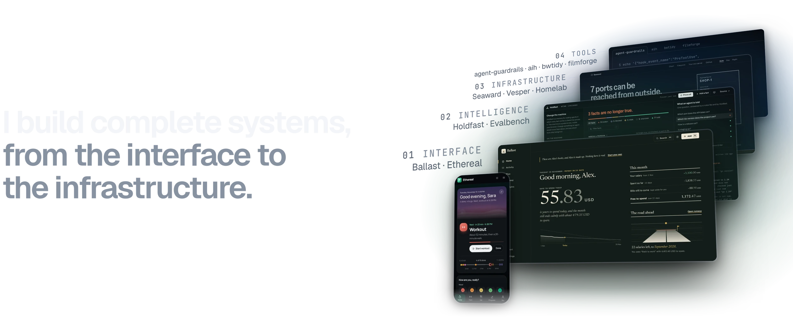

<a href="https://gallowforge.github.io#gh-dark-mode-only"><picture><source media="(prefers-color-scheme: light)" srcset="screens/blank.webp"><source media="(max-width: 767px)" srcset="screens/banner-dark-phone.webp 5x"><source srcset="screens/banner-dark.webp 3x"></picture></a><a href="https://gallowforge.github.io#gh-light-mode-only"><picture><source media="(prefers-color-scheme: dark)" srcset="screens/blank.webp"><source media="(max-width: 767px)" srcset="screens/banner-light-phone.webp 5x"><source srcset="screens/banner-light.webp 3x"></picture></a>

Everything here is tested and released: 11 public repositories, 4,503 automated tests run on every change, 15 self-hosted services in production.

**Start here:** [Holdfast](https://github.com/gallowforge/holdfast) is a memory for coding agents in which every fact carries a check that proves it. [Seaward](https://github.com/gallowforge/seaward) shows which ports on a server can really be reached from outside, and the rule that decides each one.

**Try them in your browser:** [Holdfast](https://gallowforge.github.io/holdfast/), [Seaward](https://gallowforge.github.io/seaward/), [Ballast](https://gallowforge.github.io/ballast/), [Ethereal](https://gallowforge.github.io/Ethereal/), [Evalbench](https://gallowforge.github.io/evalbench/) and [Vesper](https://gallowforge.github.io/vesper/).

[Portfolio](https://gallowforge.github.io) · [CV](https://gallowforge.github.io/assets/Ali-Husain-CV.pdf) · [ali@gallowforge.dev](mailto:ali@gallowforge.dev)
