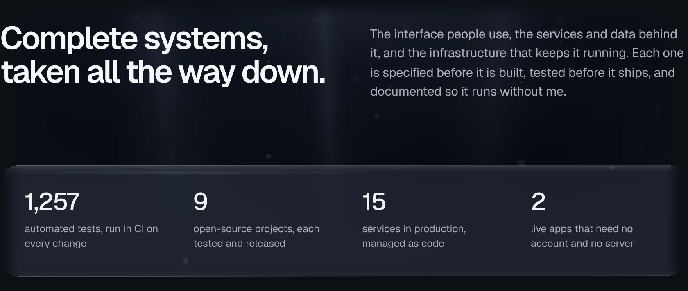
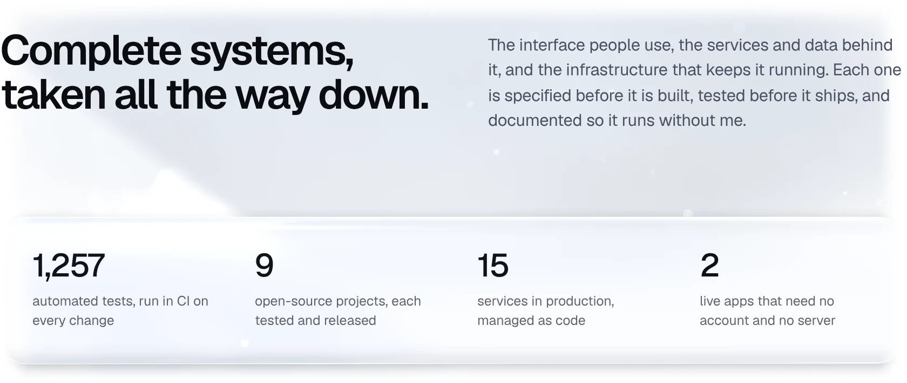
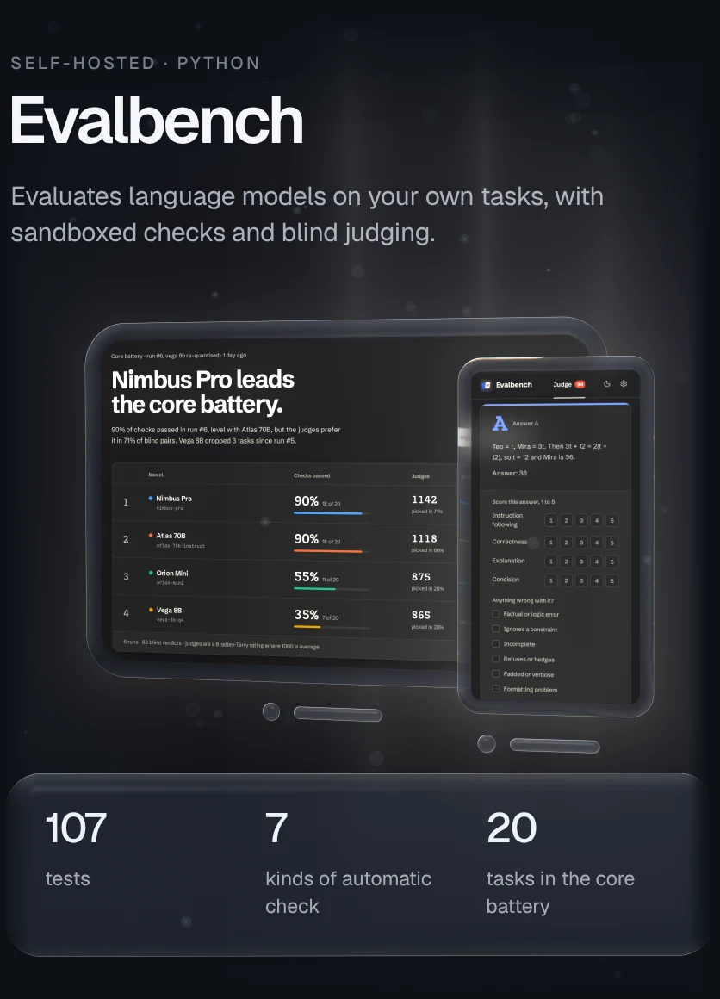
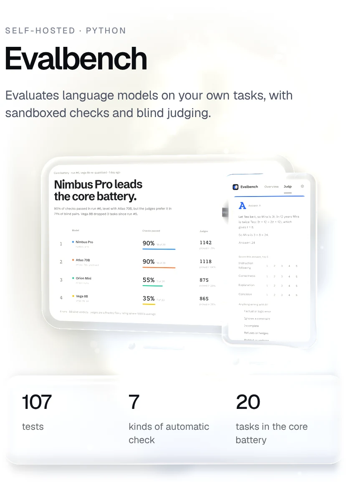
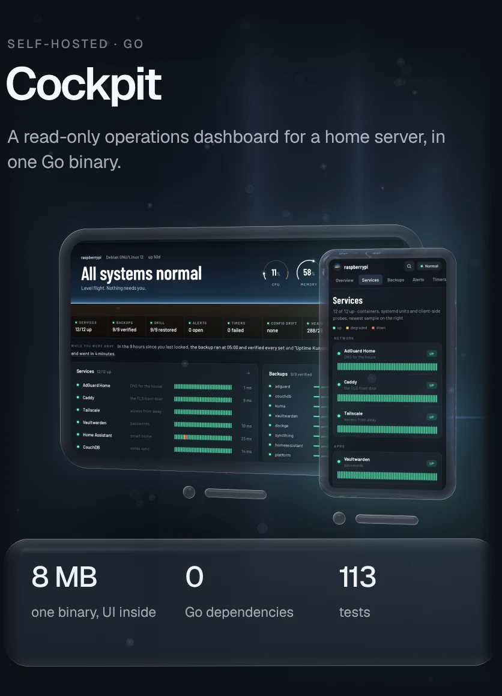
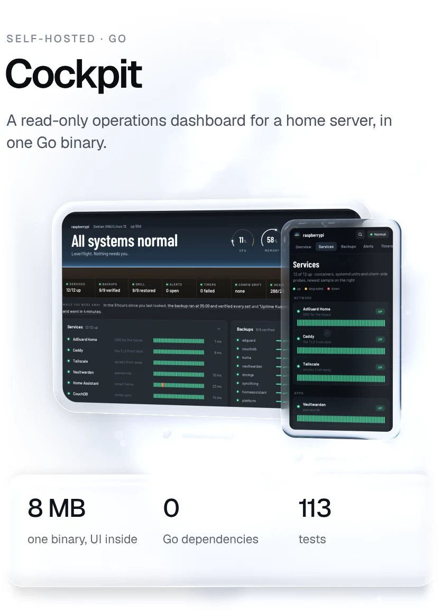
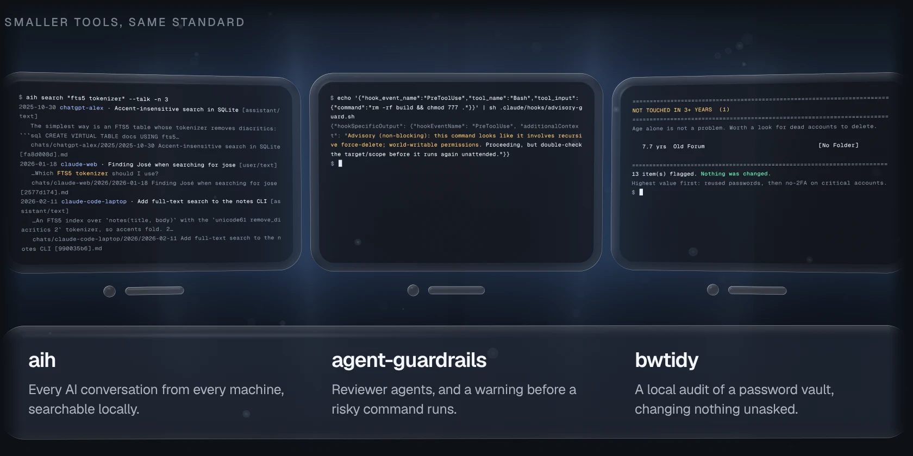
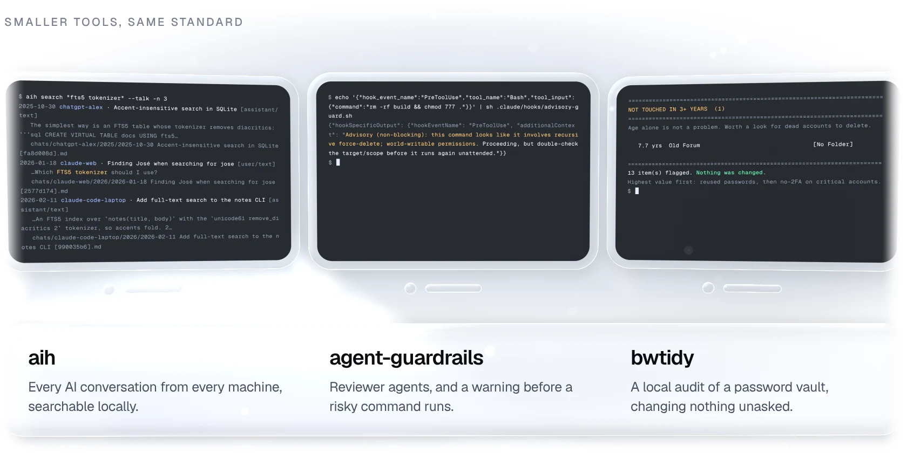
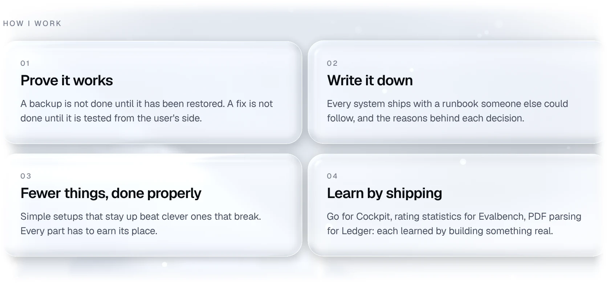

<a href="https://gallowforge.github.io#gh-dark-mode-only"><picture><source media="(max-width: 767px)" srcset="docs/hero-dark-phone.webp 2.835x"><source srcset="docs/hero-dark.webp 2x"></picture></a><a href="https://gallowforge.github.io#gh-light-mode-only"><picture><source media="(max-width: 767px)" srcset="docs/hero-light-phone.webp 2.835x"><source srcset="docs/hero-light.webp 2x"></picture></a>

<a href="https://gallowforge.github.io#gh-dark-mode-only"><picture><source media="(max-width: 767px)" srcset="docs/intro-dark-phone.webp 2.835x"><source srcset="docs/intro-dark.webp 2x"></picture></a><a href="https://gallowforge.github.io#gh-light-mode-only"><picture><source media="(max-width: 767px)" srcset="docs/intro-light-phone.webp 2.835x"><source srcset="docs/intro-light.webp 2x"></picture></a>

<a href="mailto:ali@gallowforge.dev"><picture><source media="(prefers-color-scheme: dark) and (max-width: 767px)" srcset="docs/btn-email-dark-phone.webp 3x"><source media="(prefers-color-scheme: dark)" srcset="docs/btn-email-dark.webp 2x"><source media="(max-width: 767px)" srcset="docs/btn-email-light-phone.webp 3x"><source srcset="docs/btn-email-light.webp 2x"></picture></a><a href="https://gallowforge.github.io"><picture><source media="(prefers-color-scheme: dark) and (max-width: 767px)" srcset="docs/btn-portfolio-dark-phone.webp 3x"><source media="(prefers-color-scheme: dark)" srcset="docs/btn-portfolio-dark.webp 2x"><source media="(max-width: 767px)" srcset="docs/btn-portfolio-light-phone.webp 3x"><source srcset="docs/btn-portfolio-light.webp 2x"></picture></a><a href="https://gallowforge.github.io/assets/Ali-Husain-CV.pdf"><picture><source media="(prefers-color-scheme: dark) and (max-width: 767px)" srcset="docs/btn-cv-dark-phone.webp 3x"><source media="(prefers-color-scheme: dark)" srcset="docs/btn-cv-dark.webp 2x"><source media="(max-width: 767px)" srcset="docs/btn-cv-light-phone.webp 3x"><source srcset="docs/btn-cv-light.webp 2x"></picture></a>

 

<a href="https://gallowforge.github.io/Ethereal/#gh-dark-mode-only"><picture><source media="(max-width: 767px)" srcset="docs/ethereal-dark-phone.webp 2.835x"><source srcset="docs/ethereal-dark.webp 2x"></picture></a><a href="https://gallowforge.github.io/Ethereal/#gh-light-mode-only"><picture><source media="(max-width: 767px)" srcset="docs/ethereal-light-phone.webp 2.835x"><source srcset="docs/ethereal-light.webp 2x"></picture></a>

<a href="https://gallowforge.github.io/Ethereal/"><picture><source media="(prefers-color-scheme: dark)" srcset="docs/pill-open-dark.webp 2x"><source srcset="docs/pill-open-light.webp 2x"></picture></a><a href="https://github.com/gallowforge/Ethereal"><picture><source media="(prefers-color-scheme: dark)" srcset="docs/pill-code-dark.webp 2x"><source srcset="docs/pill-code-light.webp 2x"></picture></a>

<a href="https://gallowforge.github.io/ledger/#gh-dark-mode-only"><picture><source media="(max-width: 767px)" srcset="docs/ledger-dark-phone.webp 2.835x"><source srcset="docs/ledger-dark.webp 2x"></picture></a><a href="https://gallowforge.github.io/ledger/#gh-light-mode-only"><picture><source media="(max-width: 767px)" srcset="docs/ledger-light-phone.webp 2.835x"><source srcset="docs/ledger-light.webp 2x"></picture></a>

<a href="https://gallowforge.github.io/ledger/"><picture><source media="(prefers-color-scheme: dark)" srcset="docs/pill-open-dark.webp 2x"><source srcset="docs/pill-open-light.webp 2x"></picture></a><a href="https://github.com/gallowforge/ledger"><picture><source media="(prefers-color-scheme: dark)" srcset="docs/pill-code-dark.webp 2x"><source srcset="docs/pill-code-light.webp 2x"></picture></a>

<a href="https://github.com/gallowforge/evalbench#gh-dark-mode-only"><picture><source media="(max-width: 767px)" srcset="docs/card-evalbench-dark-phone.webp 2.835x"><source srcset="docs/card-evalbench-dark.webp 2x"></picture></a><a href="https://github.com/gallowforge/evalbench#gh-light-mode-only"><picture><source media="(max-width: 767px)" srcset="docs/card-evalbench-light-phone.webp 2.835x"><source srcset="docs/card-evalbench-light.webp 2x"></picture></a> <a href="https://github.com/gallowforge/cockpit#gh-dark-mode-only"><picture><source media="(max-width: 767px)" srcset="docs/card-cockpit-dark-phone.webp 2.835x"><source srcset="docs/card-cockpit-dark.webp 2x"></picture></a><a href="https://github.com/gallowforge/cockpit#gh-light-mode-only"><picture><source media="(max-width: 767px)" srcset="docs/card-cockpit-light-phone.webp 2.835x"><source srcset="docs/card-cockpit-light.webp 2x"></picture></a>

<a href="https://github.com/gallowforge/homelab#gh-dark-mode-only"><picture><source media="(max-width: 767px)" srcset="docs/card-homelab-dark-phone.webp 2.835x"><source srcset="docs/card-homelab-dark.webp 2x"></picture></a><a href="https://github.com/gallowforge/homelab#gh-light-mode-only"><picture><source media="(max-width: 767px)" srcset="docs/card-homelab-light-phone.webp 2.835x"><source srcset="docs/card-homelab-light.webp 2x"></picture></a> <a href="https://github.com/gallowforge/filmforge#gh-dark-mode-only"><picture><source media="(max-width: 767px)" srcset="docs/card-filmforge-dark-phone.webp 2.835x"><source srcset="docs/card-filmforge-dark.webp 2x"></picture></a><a href="https://github.com/gallowforge/filmforge#gh-light-mode-only"><picture><source media="(max-width: 767px)" srcset="docs/card-filmforge-light-phone.webp 2.835x"><source srcset="docs/card-filmforge-light.webp 2x"></picture></a>

<a href="https://github.com/gallowforge/aih#gh-dark-mode-only"><picture><source media="(max-width: 767px)" srcset="docs/tools2-dark-phone.webp 2.835x"><source srcset="docs/tools2-dark.webp 2x"></picture></a><a href="https://github.com/gallowforge/aih#gh-light-mode-only"><picture><source media="(max-width: 767px)" srcset="docs/tools2-light-phone.webp 2.835x"><source srcset="docs/tools2-light.webp 2x"></picture></a>

<a href="https://github.com/gallowforge/aih"><picture><source media="(prefers-color-scheme: dark)" srcset="docs/pill-aih-dark.webp 2x"><source srcset="docs/pill-aih-light.webp 2x"></picture></a><a href="https://github.com/gallowforge/agent-guardrails"><picture><source media="(prefers-color-scheme: dark)" srcset="docs/pill-guardrails-dark.webp 2x"><source srcset="docs/pill-guardrails-light.webp 2x"></picture></a><a href="https://github.com/gallowforge/bwtidy"><picture><source media="(prefers-color-scheme: dark)" srcset="docs/pill-bwtidy-dark.webp 2x"><source srcset="docs/pill-bwtidy-light.webp 2x"></picture></a>

 

<a href="https://gallowforge.github.io#gh-dark-mode-only"><picture><source media="(max-width: 767px)" srcset="docs/principles-dark-phone.webp 2.835x"><source srcset="docs/principles-dark.webp 2x"></picture></a><a href="https://gallowforge.github.io#gh-light-mode-only"><picture><source media="(max-width: 767px)" srcset="docs/principles-light-phone.webp 2.835x"><source srcset="docs/principles-light.webp 2x"></picture></a>

<a href="mailto:ali@gallowforge.dev"><picture><source media="(prefers-color-scheme: dark) and (max-width: 767px)" srcset="docs/contact-dark-phone.webp 2.835x"><source media="(prefers-color-scheme: dark)" srcset="docs/contact-dark.webp 2x"><source media="(max-width: 767px)" srcset="docs/contact-light-phone.webp 2.835x"><source srcset="docs/contact-light.webp 2x"></picture></a>

[ali@gallowforge.dev](mailto:ali@gallowforge.dev) &nbsp;·&nbsp; [gallowforge.github.io](https://gallowforge.github.io) &nbsp;·&nbsp; Remote, UTC+3
