<a href="https://gallowforge.github.io#gh-dark-mode-only"><picture><source media="(prefers-color-scheme: light)" srcset="plates/blank.webp"><source media="(max-width: 767px)" srcset="plates/hero-dark-phone.webp 3.5x"><source srcset="plates/hero-dark.webp 2x">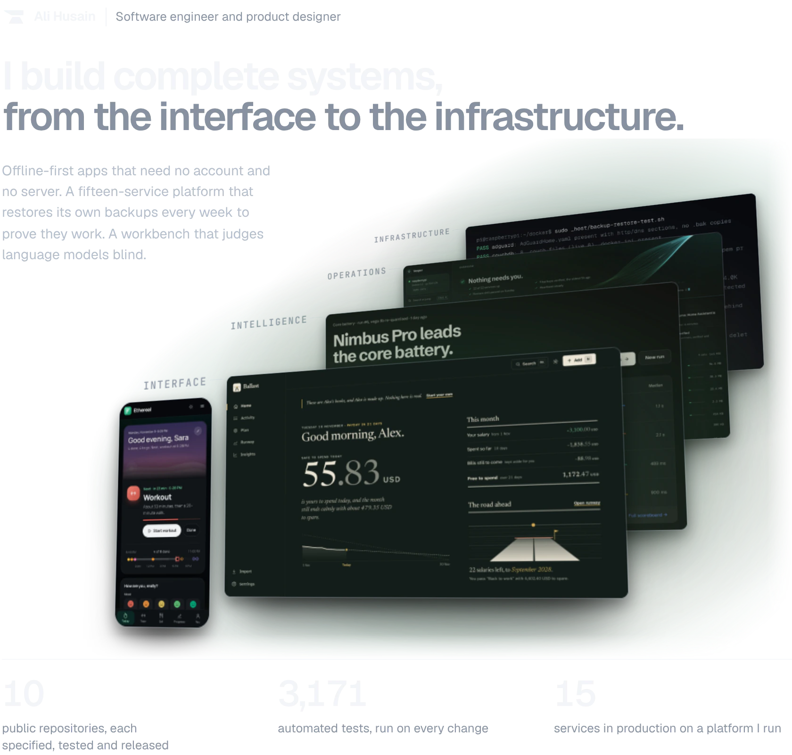</picture></a><a href="https://gallowforge.github.io#gh-light-mode-only"><picture><source media="(prefers-color-scheme: dark)" srcset="plates/blank.webp"><source media="(max-width: 767px)" srcset="plates/hero-light-phone.webp 3.5x"><source srcset="plates/hero-light.webp 2x">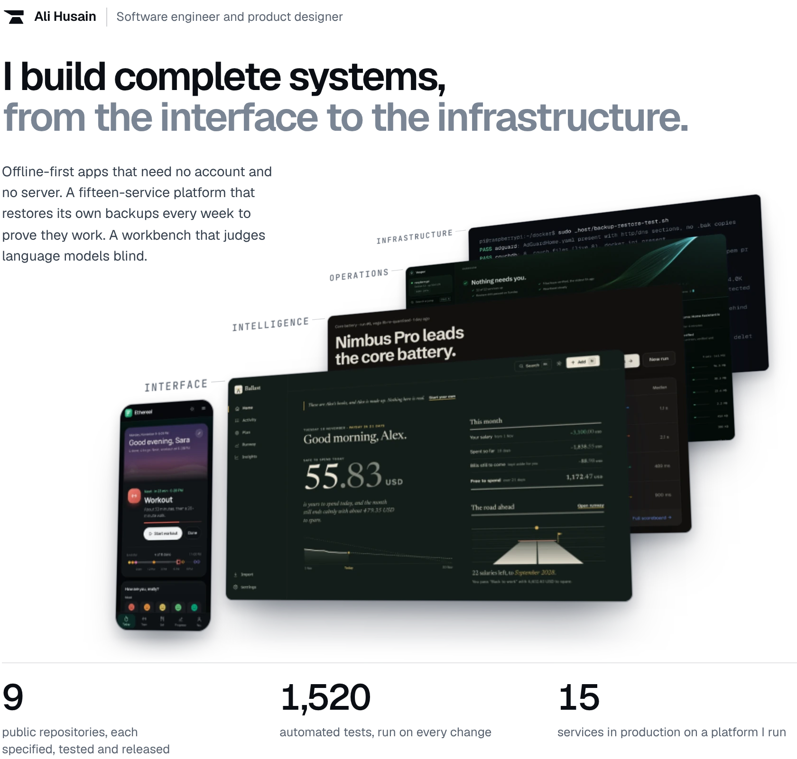</picture></a>

<a href="https://gallowforge.github.io#gh-dark-mode-only"><picture><source media="(prefers-color-scheme: light)" srcset="plates/blank.webp"><source media="(max-width: 767px)" srcset="plates/btn-site-dark-phone.webp 3.5x"><source srcset="plates/btn-site-dark.webp 2x"></picture></a><a href="https://gallowforge.github.io#gh-light-mode-only"><picture><source media="(prefers-color-scheme: dark)" srcset="plates/blank.webp"><source media="(max-width: 767px)" srcset="plates/btn-site-light-phone.webp 3.5x"><source srcset="plates/btn-site-light.webp 2x"></picture></a>&nbsp;<a href="mailto:ali@gallowforge.dev"><picture><source media="(prefers-color-scheme: light)" srcset="plates/blank.webp"><source media="(max-width: 767px)" srcset="plates/btn-email-dark-phone.webp 3.5x"><source srcset="plates/btn-email-dark.webp 2x"></picture><picture><source media="(prefers-color-scheme: dark)" srcset="plates/blank.webp"><source media="(max-width: 767px)" srcset="plates/btn-email-light-phone.webp 3.5x"><source srcset="plates/btn-email-light.webp 2x"></picture></a>&nbsp;<a href="https://gallowforge.github.io/assets/Ali-Husain-CV.pdf#gh-dark-mode-only"><picture><source media="(prefers-color-scheme: light)" srcset="plates/blank.webp"><source media="(max-width: 767px)" srcset="plates/btn-cv-dark-phone.webp 3.5x"><source srcset="plates/btn-cv-dark.webp 2x"></picture></a><a href="https://gallowforge.github.io/assets/Ali-Husain-CV.pdf#gh-light-mode-only"><picture><source media="(prefers-color-scheme: dark)" srcset="plates/blank.webp"><source media="(max-width: 767px)" srcset="plates/btn-cv-light-phone.webp 3.5x"><source srcset="plates/btn-cv-light.webp 2x"></picture></a>

 

<a href="https://gallowforge.github.io/ballast/#gh-dark-mode-only"><picture><source media="(prefers-color-scheme: light)" srcset="plates/blank.webp"><source media="(max-width: 767px)" srcset="plates/ballast-dark-phone.webp 3.5x"><source srcset="plates/ballast-dark.webp 2x">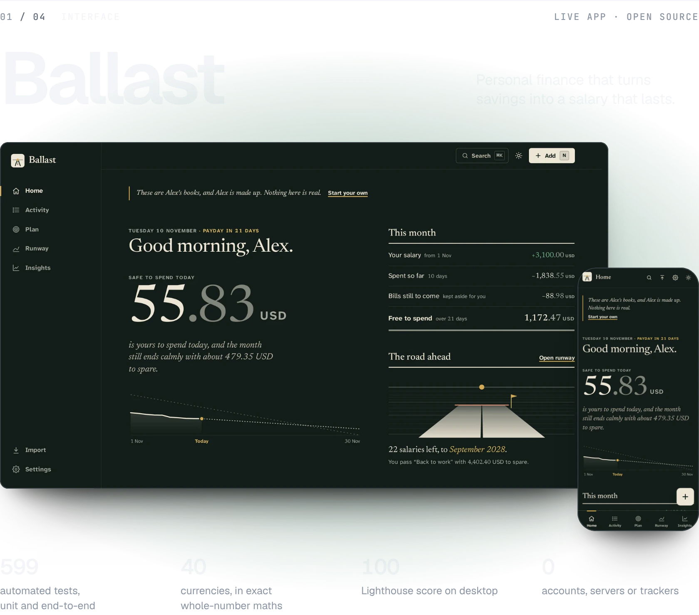</picture></a><a href="https://gallowforge.github.io/ballast/#gh-light-mode-only"><picture><source media="(prefers-color-scheme: dark)" srcset="plates/blank.webp"><source media="(max-width: 767px)" srcset="plates/ballast-light-phone.webp 3.5x"><source srcset="plates/ballast-light.webp 2x">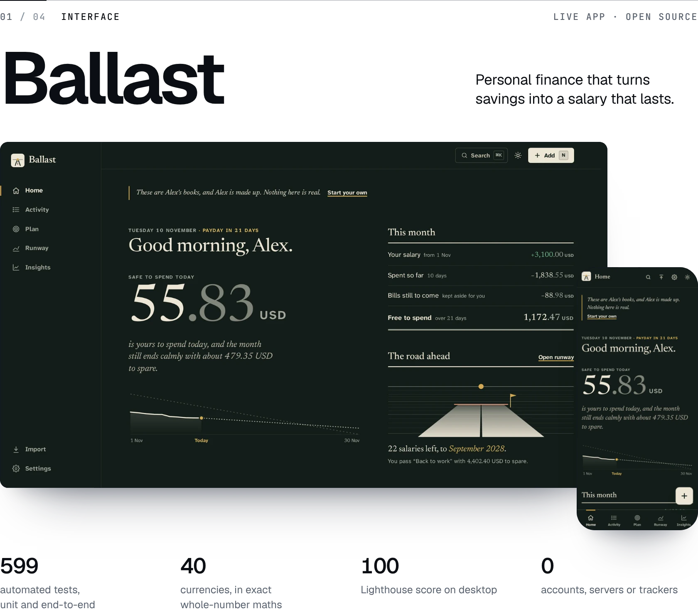</picture></a>

<a href="https://gallowforge.github.io/ballast/#gh-dark-mode-only"><picture><source media="(prefers-color-scheme: light)" srcset="plates/blank.webp"><source media="(max-width: 767px)" srcset="plates/btn-open-dark-phone.webp 3.5x"><source srcset="plates/btn-open-dark.webp 2x"></picture></a><a href="https://gallowforge.github.io/ballast/#gh-light-mode-only"><picture><source media="(prefers-color-scheme: dark)" srcset="plates/blank.webp"><source media="(max-width: 767px)" srcset="plates/btn-open-light-phone.webp 3.5x"><source srcset="plates/btn-open-light.webp 2x"></picture></a>&nbsp;<a href="https://github.com/gallowforge/ballast#gh-dark-mode-only"><picture><source media="(prefers-color-scheme: light)" srcset="plates/blank.webp"><source media="(max-width: 767px)" srcset="plates/btn-code-dark-phone.webp 3.5x"><source srcset="plates/btn-code-dark.webp 2x"></picture></a><a href="https://github.com/gallowforge/ballast#gh-light-mode-only"><picture><source media="(prefers-color-scheme: dark)" srcset="plates/blank.webp"><source media="(max-width: 767px)" srcset="plates/btn-code-light-phone.webp 3.5x"><source srcset="plates/btn-code-light.webp 2x"></picture></a>

 

<a href="https://gallowforge.github.io/Ethereal/#gh-dark-mode-only"><picture><source media="(prefers-color-scheme: light)" srcset="plates/blank.webp"><source media="(max-width: 767px)" srcset="plates/ethereal-dark-phone.webp 3.5x"><source srcset="plates/ethereal-dark.webp 2x">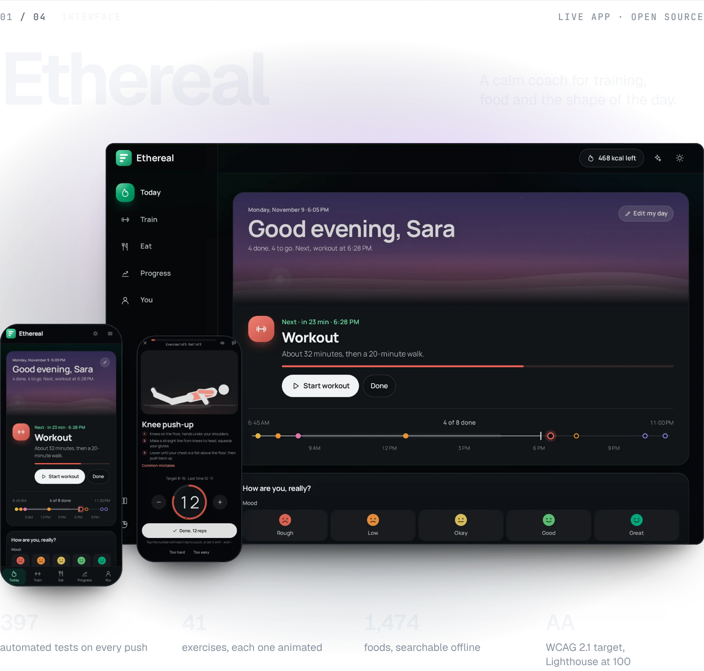</picture></a><a href="https://gallowforge.github.io/Ethereal/#gh-light-mode-only"><picture><source media="(prefers-color-scheme: dark)" srcset="plates/blank.webp"><source media="(max-width: 767px)" srcset="plates/ethereal-light-phone.webp 3.5x"><source srcset="plates/ethereal-light.webp 2x">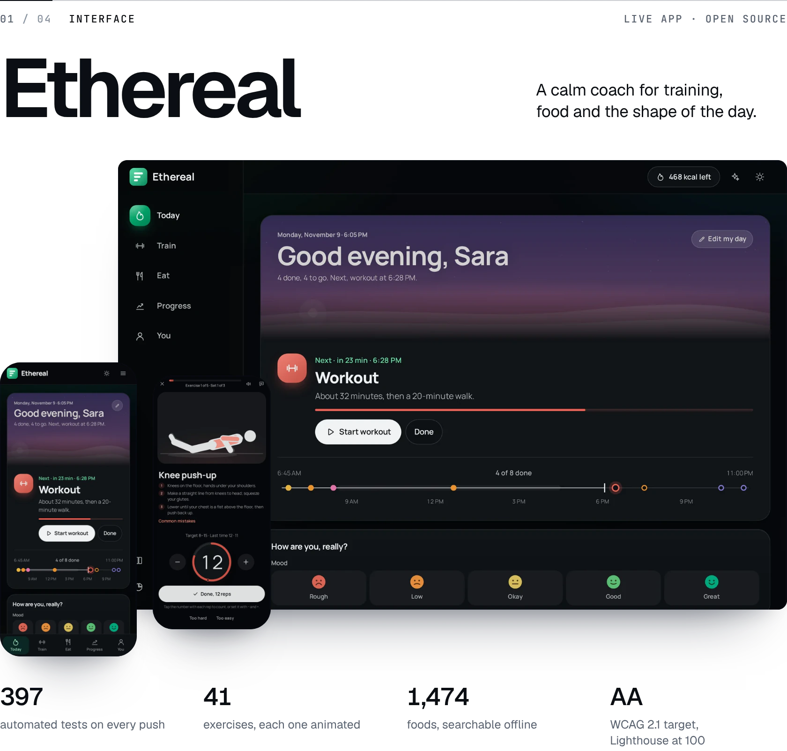</picture></a>

<a href="https://gallowforge.github.io/Ethereal/#gh-dark-mode-only"><picture><source media="(prefers-color-scheme: light)" srcset="plates/blank.webp"><source media="(max-width: 767px)" srcset="plates/btn-open-dark-phone.webp 3.5x"><source srcset="plates/btn-open-dark.webp 2x"></picture></a><a href="https://gallowforge.github.io/Ethereal/#gh-light-mode-only"><picture><source media="(prefers-color-scheme: dark)" srcset="plates/blank.webp"><source media="(max-width: 767px)" srcset="plates/btn-open-light-phone.webp 3.5x"><source srcset="plates/btn-open-light.webp 2x"></picture></a>&nbsp;<a href="https://github.com/gallowforge/Ethereal#gh-dark-mode-only"><picture><source media="(prefers-color-scheme: light)" srcset="plates/blank.webp"><source media="(max-width: 767px)" srcset="plates/btn-code-dark-phone.webp 3.5x"><source srcset="plates/btn-code-dark.webp 2x"></picture></a><a href="https://github.com/gallowforge/Ethereal#gh-light-mode-only"><picture><source media="(prefers-color-scheme: dark)" srcset="plates/blank.webp"><source media="(max-width: 767px)" srcset="plates/btn-code-light-phone.webp 3.5x"><source srcset="plates/btn-code-light.webp 2x"></picture></a>

 

<a href="https://gallowforge.github.io/evalbench/#gh-dark-mode-only"><picture><source media="(prefers-color-scheme: light)" srcset="plates/blank.webp"><source media="(max-width: 767px)" srcset="plates/evalbench-dark-phone.webp 3.5x"><source srcset="plates/evalbench-dark.webp 2x">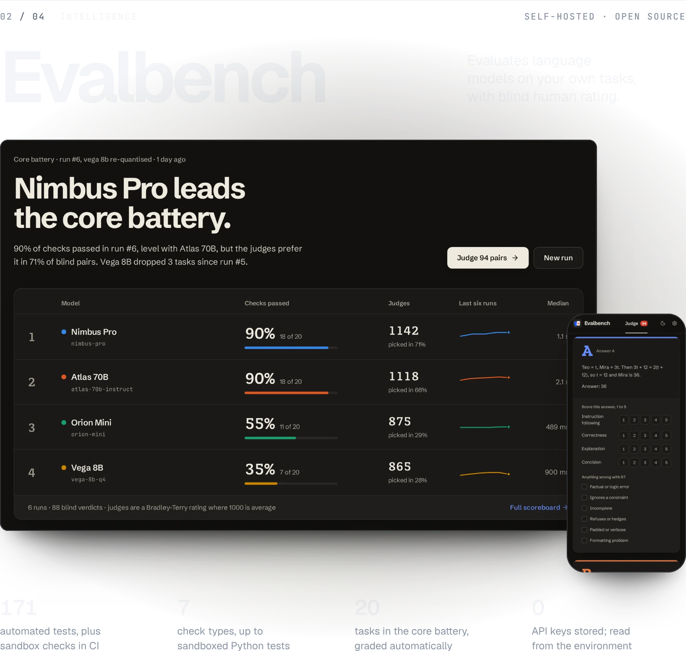</picture></a><a href="https://gallowforge.github.io/evalbench/#gh-light-mode-only"><picture><source media="(prefers-color-scheme: dark)" srcset="plates/blank.webp"><source media="(max-width: 767px)" srcset="plates/evalbench-light-phone.webp 3.5x"><source srcset="plates/evalbench-light.webp 2x">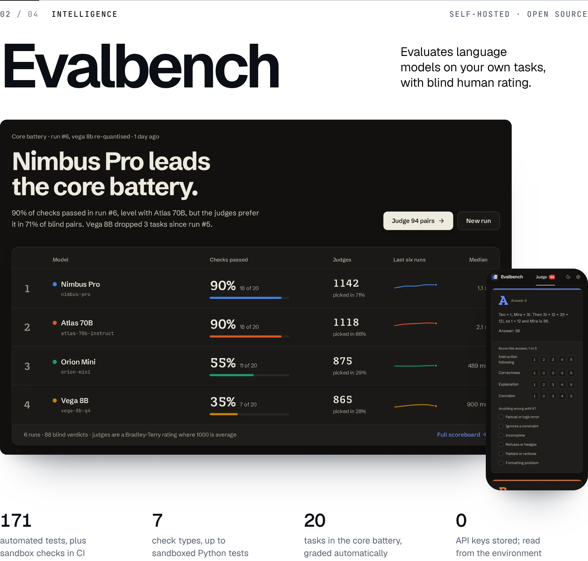</picture></a>

<a href="https://gallowforge.github.io/evalbench/#gh-dark-mode-only"><picture><source media="(prefers-color-scheme: light)" srcset="plates/blank.webp"><source media="(max-width: 767px)" srcset="plates/btn-demo-dark-phone.webp 3.5x"><source srcset="plates/btn-demo-dark.webp 2x"></picture></a><a href="https://gallowforge.github.io/evalbench/#gh-light-mode-only"><picture><source media="(prefers-color-scheme: dark)" srcset="plates/blank.webp"><source media="(max-width: 767px)" srcset="plates/btn-demo-light-phone.webp 3.5x"><source srcset="plates/btn-demo-light.webp 2x"></picture></a>&nbsp;<a href="https://github.com/gallowforge/evalbench#gh-dark-mode-only"><picture><source media="(prefers-color-scheme: light)" srcset="plates/blank.webp"><source media="(max-width: 767px)" srcset="plates/btn-code-dark-phone.webp 3.5x"><source srcset="plates/btn-code-dark.webp 2x"></picture></a><a href="https://github.com/gallowforge/evalbench#gh-light-mode-only"><picture><source media="(prefers-color-scheme: dark)" srcset="plates/blank.webp"><source media="(max-width: 767px)" srcset="plates/btn-code-light-phone.webp 3.5x"><source srcset="plates/btn-code-light.webp 2x"></picture></a>

 

<a href="https://gallowforge.github.io/vesper/#gh-dark-mode-only"><picture><source media="(prefers-color-scheme: light)" srcset="plates/blank.webp"><source media="(max-width: 767px)" srcset="plates/vesper-dark-phone.webp 3.5x"><source srcset="plates/vesper-dark.webp 2x">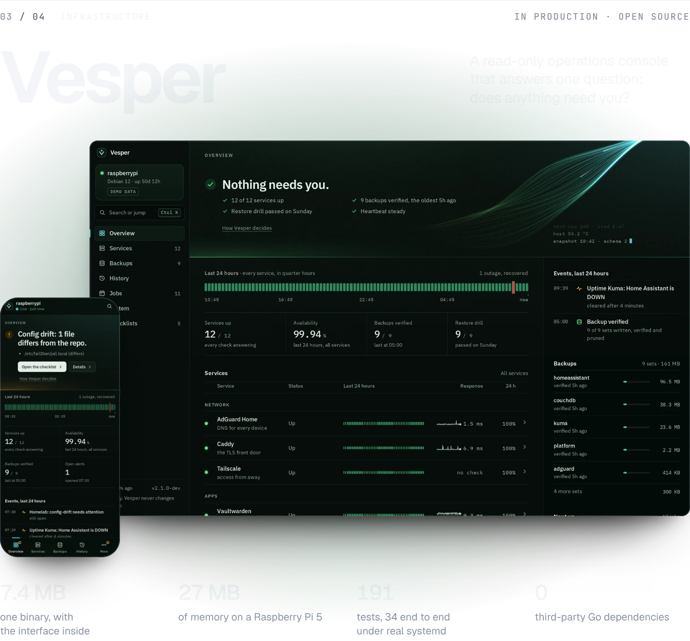</picture></a><a href="https://gallowforge.github.io/vesper/#gh-light-mode-only"><picture><source media="(prefers-color-scheme: dark)" srcset="plates/blank.webp"><source media="(max-width: 767px)" srcset="plates/vesper-light-phone.webp 3.5x"><source srcset="plates/vesper-light.webp 2x">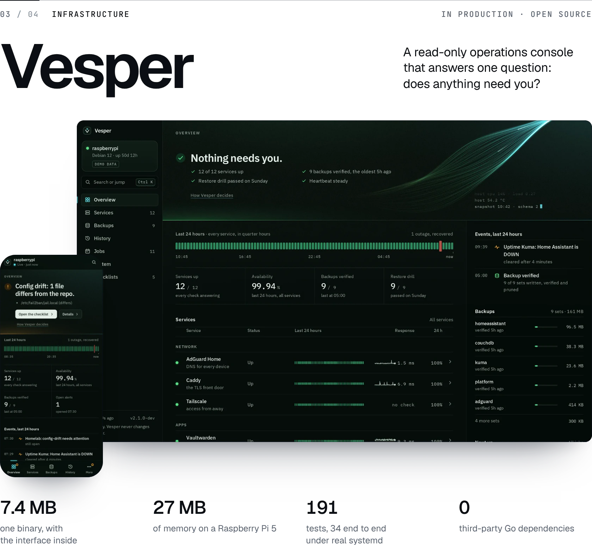</picture></a>

<a href="https://gallowforge.github.io/vesper/#gh-dark-mode-only"><picture><source media="(prefers-color-scheme: light)" srcset="plates/blank.webp"><source media="(max-width: 767px)" srcset="plates/btn-demo-dark-phone.webp 3.5x"><source srcset="plates/btn-demo-dark.webp 2x"></picture></a><a href="https://gallowforge.github.io/vesper/#gh-light-mode-only"><picture><source media="(prefers-color-scheme: dark)" srcset="plates/blank.webp"><source media="(max-width: 767px)" srcset="plates/btn-demo-light-phone.webp 3.5x"><source srcset="plates/btn-demo-light.webp 2x"></picture></a>&nbsp;<a href="https://github.com/gallowforge/vesper#gh-dark-mode-only"><picture><source media="(prefers-color-scheme: light)" srcset="plates/blank.webp"><source media="(max-width: 767px)" srcset="plates/btn-code-dark-phone.webp 3.5x"><source srcset="plates/btn-code-dark.webp 2x"></picture></a><a href="https://github.com/gallowforge/vesper#gh-light-mode-only"><picture><source media="(prefers-color-scheme: dark)" srcset="plates/blank.webp"><source media="(max-width: 767px)" srcset="plates/btn-code-light-phone.webp 3.5x"><source srcset="plates/btn-code-light.webp 2x"></picture></a>

 

<a href="https://github.com/gallowforge/homelab#gh-dark-mode-only"><picture><source media="(prefers-color-scheme: light)" srcset="plates/blank.webp"><source media="(max-width: 767px)" srcset="plates/homelab-dark-phone.webp 3.5x"><source srcset="plates/homelab-dark.webp 2x">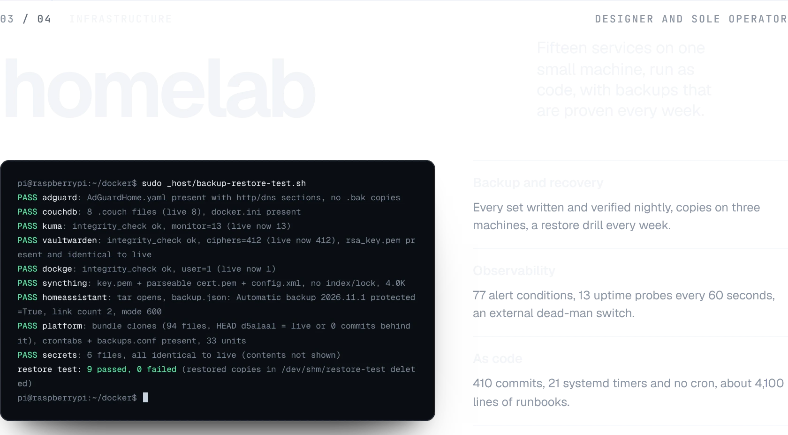</picture></a><a href="https://github.com/gallowforge/homelab#gh-light-mode-only"><picture><source media="(prefers-color-scheme: dark)" srcset="plates/blank.webp"><source media="(max-width: 767px)" srcset="plates/homelab-light-phone.webp 3.5x"><source srcset="plates/homelab-light.webp 2x">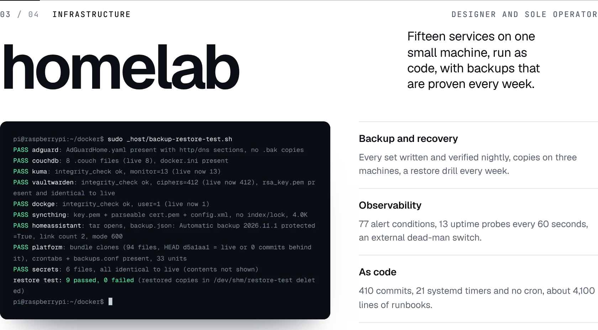</picture></a>

<a href="https://github.com/gallowforge/homelab#gh-dark-mode-only"><picture><source media="(prefers-color-scheme: light)" srcset="plates/blank.webp"><source media="(max-width: 767px)" srcset="plates/btn-code-dark-phone.webp 3.5x"><source srcset="plates/btn-code-dark.webp 2x"></picture></a><a href="https://github.com/gallowforge/homelab#gh-light-mode-only"><picture><source media="(prefers-color-scheme: dark)" srcset="plates/blank.webp"><source media="(max-width: 767px)" srcset="plates/btn-code-light-phone.webp 3.5x"><source srcset="plates/btn-code-light.webp 2x"></picture></a>

 

<a href="https://github.com/gallowforge?tab=repositories#gh-dark-mode-only"><picture><source media="(prefers-color-scheme: light)" srcset="plates/blank.webp"><source media="(max-width: 767px)" srcset="plates/tools-head-dark-phone.webp 3.5x"><source srcset="plates/tools-head-dark.webp 2x"></picture></a><a href="https://github.com/gallowforge?tab=repositories#gh-light-mode-only"><picture><source media="(prefers-color-scheme: dark)" srcset="plates/blank.webp"><source media="(max-width: 767px)" srcset="plates/tools-head-light-phone.webp 3.5x"><source srcset="plates/tools-head-light.webp 2x">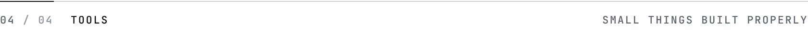</picture></a><a href="https://github.com/gallowforge/agent-guardrails#gh-dark-mode-only"><picture><source media="(prefers-color-scheme: light)" srcset="plates/blank.webp"><source media="(max-width: 767px)" srcset="plates/tool-agent-guardrails-dark-phone.webp 3.5x"><source srcset="plates/tool-agent-guardrails-dark.webp 2x">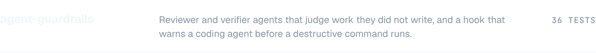</picture></a><a href="https://github.com/gallowforge/agent-guardrails#gh-light-mode-only"><picture><source media="(prefers-color-scheme: dark)" srcset="plates/blank.webp"><source media="(max-width: 767px)" srcset="plates/tool-agent-guardrails-light-phone.webp 3.5x"><source srcset="plates/tool-agent-guardrails-light.webp 2x"></picture></a><a href="https://github.com/gallowforge/aih#gh-dark-mode-only"><picture><source media="(prefers-color-scheme: light)" srcset="plates/blank.webp"><source media="(max-width: 767px)" srcset="plates/tool-aih-dark-phone.webp 3.5x"><source srcset="plates/tool-aih-dark.webp 2x">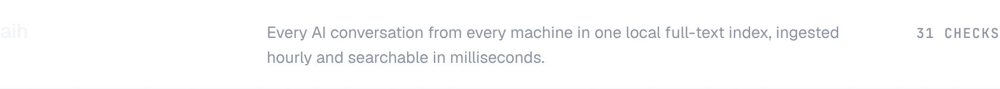</picture></a><a href="https://github.com/gallowforge/aih#gh-light-mode-only"><picture><source media="(prefers-color-scheme: dark)" srcset="plates/blank.webp"><source media="(max-width: 767px)" srcset="plates/tool-aih-light-phone.webp 3.5x"><source srcset="plates/tool-aih-light.webp 2x">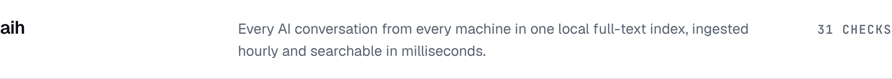</picture></a><a href="https://github.com/gallowforge/bwtidy#gh-dark-mode-only"><picture><source media="(prefers-color-scheme: light)" srcset="plates/blank.webp"><source media="(max-width: 767px)" srcset="plates/tool-bwtidy-dark-phone.webp 3.5x"><source srcset="plates/tool-bwtidy-dark.webp 2x"></picture></a><a href="https://github.com/gallowforge/bwtidy#gh-light-mode-only"><picture><source media="(prefers-color-scheme: dark)" srcset="plates/blank.webp"><source media="(max-width: 767px)" srcset="plates/tool-bwtidy-light-phone.webp 3.5x"><source srcset="plates/tool-bwtidy-light.webp 2x"></picture></a><a href="https://github.com/gallowforge/filmforge#gh-dark-mode-only"><picture><source media="(prefers-color-scheme: light)" srcset="plates/blank.webp"><source media="(max-width: 767px)" srcset="plates/tool-filmforge-dark-phone.webp 3.5x"><source srcset="plates/tool-filmforge-dark.webp 2x">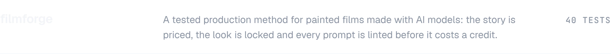</picture></a><a href="https://github.com/gallowforge/filmforge#gh-light-mode-only"><picture><source media="(prefers-color-scheme: dark)" srcset="plates/blank.webp"><source media="(max-width: 767px)" srcset="plates/tool-filmforge-light-phone.webp 3.5x"><source srcset="plates/tool-filmforge-light.webp 2x">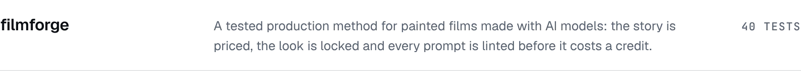</picture></a>

 

<a href="https://gallowforge.github.io#gh-dark-mode-only"><picture><source media="(prefers-color-scheme: light)" srcset="plates/blank.webp"><source media="(max-width: 767px)" srcset="plates/contact-dark-phone.webp 3.5x"><source srcset="plates/contact-dark.webp 2x"></picture></a><a href="https://gallowforge.github.io#gh-light-mode-only"><picture><source media="(prefers-color-scheme: dark)" srcset="plates/blank.webp"><source media="(max-width: 767px)" srcset="plates/contact-light-phone.webp 3.5x"><source srcset="plates/contact-light.webp 2x"></picture></a>

<a href="mailto:ali@gallowforge.dev"><picture><source media="(prefers-color-scheme: light)" srcset="plates/blank.webp"><source media="(max-width: 767px)" srcset="plates/btn-email-dark-phone.webp 3.5x"><source srcset="plates/btn-email-dark.webp 2x"></picture><picture><source media="(prefers-color-scheme: dark)" srcset="plates/blank.webp"><source media="(max-width: 767px)" srcset="plates/btn-email-light-phone.webp 3.5x"><source srcset="plates/btn-email-light.webp 2x"></picture></a>&nbsp;<a href="https://gallowforge.github.io#gh-dark-mode-only"><picture><source media="(prefers-color-scheme: light)" srcset="plates/blank.webp"><source media="(max-width: 767px)" srcset="plates/btn-site-dark-phone.webp 3.5x"><source srcset="plates/btn-site-dark.webp 2x"></picture></a><a href="https://gallowforge.github.io#gh-light-mode-only"><picture><source media="(prefers-color-scheme: dark)" srcset="plates/blank.webp"><source media="(max-width: 767px)" srcset="plates/btn-site-light-phone.webp 3.5x"><source srcset="plates/btn-site-light.webp 2x"></picture></a>&nbsp;<a href="https://gallowforge.github.io/assets/Ali-Husain-CV.pdf#gh-dark-mode-only"><picture><source media="(prefers-color-scheme: light)" srcset="plates/blank.webp"><source media="(max-width: 767px)" srcset="plates/btn-cv-dark-phone.webp 3.5x"><source srcset="plates/btn-cv-dark.webp 2x"></picture></a><a href="https://gallowforge.github.io/assets/Ali-Husain-CV.pdf#gh-light-mode-only"><picture><source media="(prefers-color-scheme: dark)" srcset="plates/blank.webp"><source media="(max-width: 767px)" srcset="plates/btn-cv-light-phone.webp 3.5x"><source srcset="plates/btn-cv-light.webp 2x"></picture></a>
