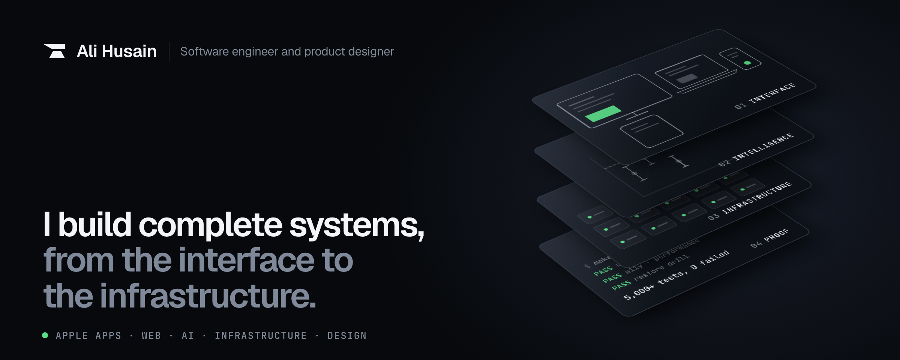

<a href="https://gallowforge.github.io"><picture><source media="(prefers-color-scheme: light)" srcset="screens/banner-cap-light.png"></picture></a>

**Software engineer and product designer.** I take software from a blank page to a release on my own: the specification, the interface, the code, the infrastructure it runs on, the tests and the documentation. Specified before it is built, tested before it ships, documented so it runs without me.

**In numbers**

- **5,000+** automated tests across 12 projects, run on every change
- **4** Apple platforms from one native codebase: iPhone, iPad, Mac and Apple TV
- **15** self-hosted services in production on a platform I designed and operate

## What I build

- **Native Apple apps.** One SwiftUI codebase across iPhone, iPad, Mac and Apple TV: SwiftData with private iCloud sync, widgets, Live Activities and App Intents, in modular Swift packages with about 700 automated tests.
- **Web apps, services and tools.** Installable apps that work offline with no account or server, services and command-line tools in Go, Python and TypeScript, engines compiled to WebAssembly. Lighthouse 100 in all four categories; three static Go binaries with no third-party dependencies.
- **AI and LLM systems.** Model evaluation with rubrics, automatic checks, sandboxed code tests and blind pairwise rating scored with Bradley-Terry ratings; agent memory, tool servers, hooks and reviewer agents. Over 400 agent runs, in coordinated teams of up to 98 agents.
- **Infrastructure, security and reliability.** Linux, containers, systemd, CI/CD and infrastructure as code with drift checks; DNS over HTTPS with DNSSEC, TLS and a mesh VPN with zero port forwards; nine backup sets restored every week to prove them, 77 alert conditions and 13 uptime probes.
- **Product design and UX.** Interfaces designed for phone and desktop together, a design system for each product in light and dark, accessibility swept against WCAG 2.1 AA.
- **Video, audio and creative production.** Films made with AI image and video models and finished in code: a beat tracker written from scratch, broadcast loudness and 4K mastering on the GPU.

## How I work

**Specify → design → build → test → ship.** A fix is not done until it is tested from the user's side, and a backup is not done until it has been restored. Every system ships with a runbook someone else could follow. Agents build to my specification, an independent reviewer checks the work, and I verify it before it ships. Private by design: no trackers, data on the device or the user's own cloud, secrets never in code.

**Toolkit:** Swift, Go, Python, TypeScript, Bash, SQL, C and C++ · SwiftUI, SwiftData, CloudKit, WidgetKit · Astro, Preact, React, WebAssembly · FastAPI, SQLite · Playwright, Vitest, XCTest, Lighthouse CI, Go fuzzing · Linux, Docker, systemd, Caddy, GitHub Actions · coding agents, MCP tool servers, model APIs · ffmpeg.

**Background:** Computer Science and Engineering.

**Open to remote work.** Remote, on UTC+3: the full European working day overlaps. Walkthroughs of the work itself are available privately, on request.

[Portfolio](https://gallowforge.github.io) · [CV](https://gallowforge.github.io/assets/Ali-Husain-CV.pdf) · [ali@gallowforge.dev](mailto:ali@gallowforge.dev)
