<a href="https://gallowforge.github.io#gh-dark-mode-only"><picture><source media="(max-width: 767px)" srcset="docs/hero-dark-phone.webp 2.835x"><source srcset="docs/hero-dark.webp 2x"></picture></a><a href="https://gallowforge.github.io#gh-light-mode-only"><picture><source media="(max-width: 767px)" srcset="docs/hero-light-phone.webp 2.835x"><source srcset="docs/hero-light.webp 2x"></picture></a>

I design and build complete systems: the interface people use, the data and services behind it, and the infrastructure that keeps it running. Offline-first web apps that need no account and no server, a fifteen-service platform that restores its own backups every week to prove they work, and tools that check what AI agents do before it reaches a real machine.

I take every project all the way down. It is specified before it is built, tested before it ships, and documented so it can run without me. Across these repositories, more than 1,200 automated tests run on every change.

[Portfolio](https://gallowforge.github.io) · [CV](https://gallowforge.github.io/assets/Ali-Husain-CV.pdf) · [Email](mailto:ali@gallowforge.dev)

 

<a href="https://gallowforge.github.io/Ethereal/#gh-dark-mode-only"><picture><source media="(max-width: 767px)" srcset="docs/ethereal-dark-phone.webp 2.835x"><source srcset="docs/ethereal-dark.webp 2x">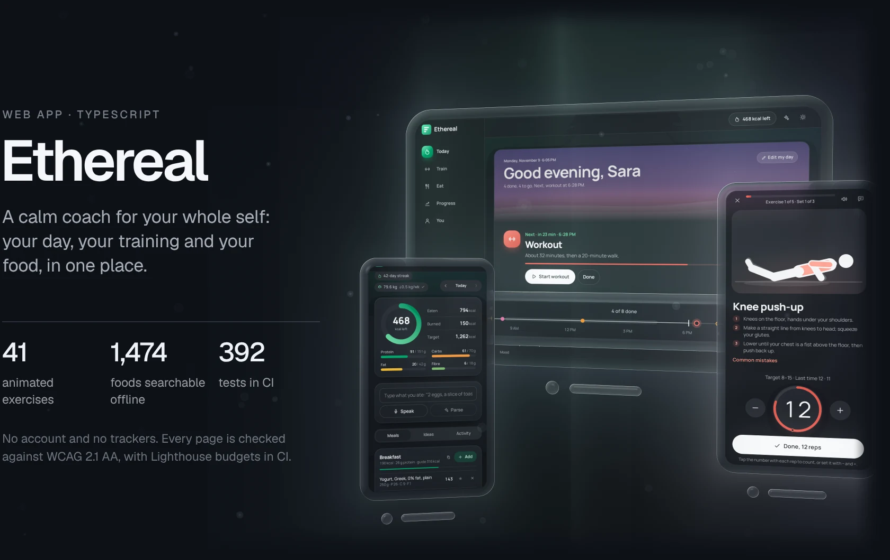</picture></a><a href="https://gallowforge.github.io/Ethereal/#gh-light-mode-only"><picture><source media="(max-width: 767px)" srcset="docs/ethereal-light-phone.webp 2.835x"><source srcset="docs/ethereal-light.webp 2x"></picture></a>

[Open the app](https://gallowforge.github.io/Ethereal/) &nbsp;·&nbsp; [View the code](https://github.com/gallowforge/Ethereal)

<a href="https://gallowforge.github.io/ledger/#gh-dark-mode-only"><picture><source media="(max-width: 767px)" srcset="docs/ledger-dark-phone.webp 2.835x"><source srcset="docs/ledger-dark.webp 2x">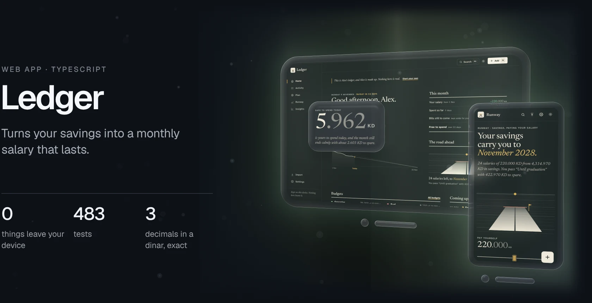</picture></a><a href="https://gallowforge.github.io/ledger/#gh-light-mode-only"><picture><source media="(max-width: 767px)" srcset="docs/ledger-light-phone.webp 2.835x"><source srcset="docs/ledger-light.webp 2x">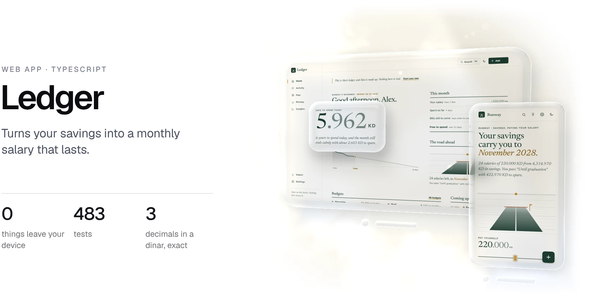</picture></a>

[Open the app](https://gallowforge.github.io/ledger/) &nbsp;·&nbsp; [View the code](https://github.com/gallowforge/ledger)

<a href="https://github.com/gallowforge/evalbench#gh-dark-mode-only"><picture><source media="(max-width: 767px)" srcset="docs/evalbench-dark-phone.webp 2.835x"><source srcset="docs/evalbench-dark.webp 2x">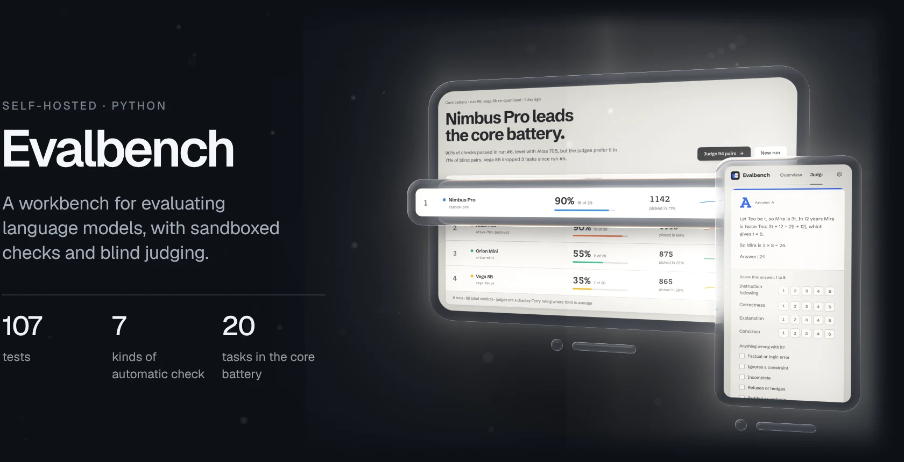</picture></a><a href="https://github.com/gallowforge/evalbench#gh-light-mode-only"><picture><source media="(max-width: 767px)" srcset="docs/evalbench-light-phone.webp 2.835x"><source srcset="docs/evalbench-light.webp 2x">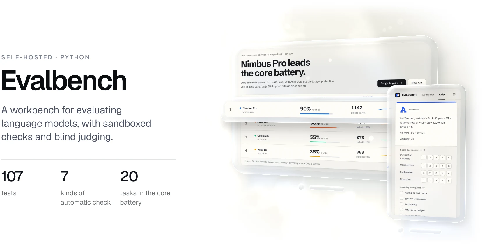</picture></a>

[View the code](https://github.com/gallowforge/evalbench)

<a href="https://github.com/gallowforge/cockpit#gh-dark-mode-only"><picture><source media="(max-width: 767px)" srcset="docs/cockpit-dark-phone.webp 2.835x"><source srcset="docs/cockpit-dark.webp 2x">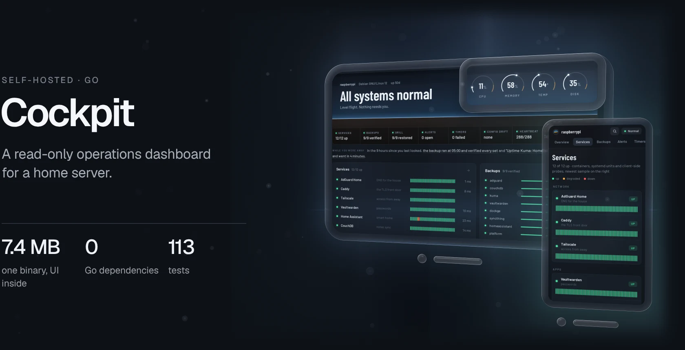</picture></a><a href="https://github.com/gallowforge/cockpit#gh-light-mode-only"><picture><source media="(max-width: 767px)" srcset="docs/cockpit-light-phone.webp 2.835x"><source srcset="docs/cockpit-light.webp 2x">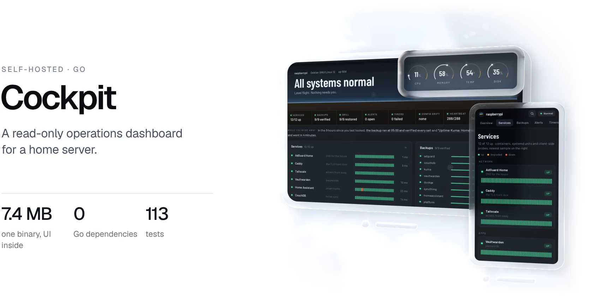</picture></a>

[View the code](https://github.com/gallowforge/cockpit)

<a href="https://github.com/gallowforge/homelab#gh-dark-mode-only"><picture><source media="(max-width: 767px)" srcset="docs/homelab-dark-phone.webp 2.835x"><source srcset="docs/homelab-dark.webp 2x">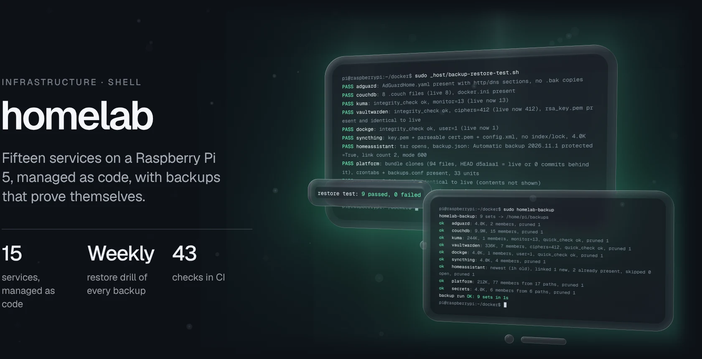</picture></a><a href="https://github.com/gallowforge/homelab#gh-light-mode-only"><picture><source media="(max-width: 767px)" srcset="docs/homelab-light-phone.webp 2.835x"><source srcset="docs/homelab-light.webp 2x">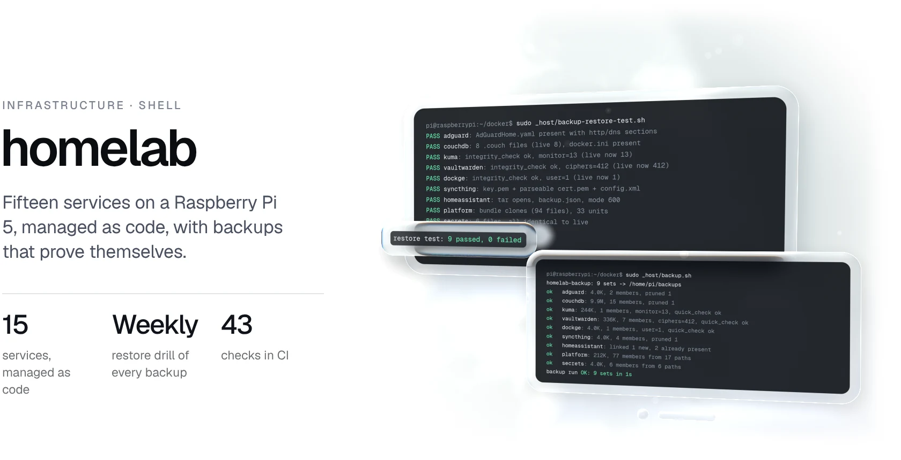</picture></a>

[View the code](https://github.com/gallowforge/homelab)

<a href="https://github.com/gallowforge/filmforge#gh-dark-mode-only"><picture><source media="(max-width: 767px)" srcset="docs/filmforge-dark-phone.webp 2.835x"><source srcset="docs/filmforge-dark.webp 2x">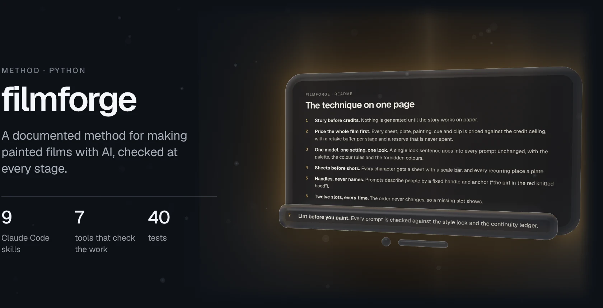</picture></a><a href="https://github.com/gallowforge/filmforge#gh-light-mode-only"><picture><source media="(max-width: 767px)" srcset="docs/filmforge-light-phone.webp 2.835x"><source srcset="docs/filmforge-light.webp 2x">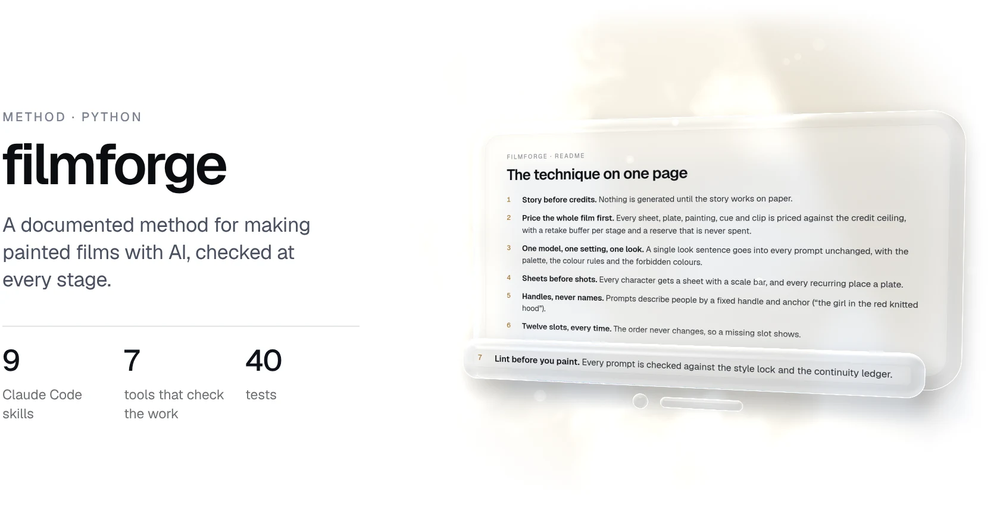</picture></a>

[View the code](https://github.com/gallowforge/filmforge)

<a href="https://github.com/gallowforge/aih#gh-dark-mode-only"><picture><source media="(max-width: 767px)" srcset="docs/tools-dark-phone.webp 2.835x"><source srcset="docs/tools-dark.webp 2x">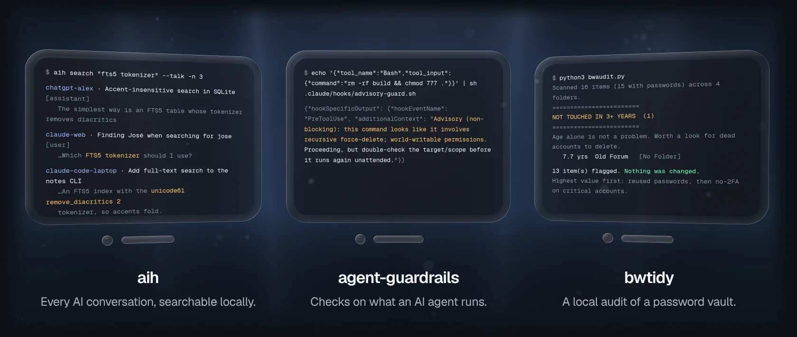</picture></a><a href="https://github.com/gallowforge/aih#gh-light-mode-only"><picture><source media="(max-width: 767px)" srcset="docs/tools-light-phone.webp 2.835x"><source srcset="docs/tools-light.webp 2x">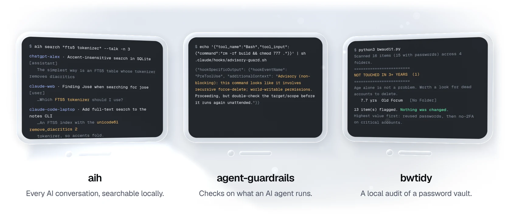</picture></a>

[aih](https://github.com/gallowforge/aih) &nbsp;·&nbsp; [agent-guardrails](https://github.com/gallowforge/agent-guardrails) &nbsp;·&nbsp; [bwtidy](https://github.com/gallowforge/bwtidy)

 

Open to remote work. [ali@gallowforge.dev](mailto:ali@gallowforge.dev)
