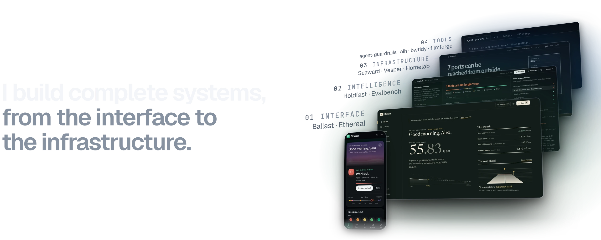

<a href="https://gallowforge.github.io#gh-dark-mode-only"><picture><source media="(prefers-color-scheme: light)" srcset="screens/blank.webp"><source media="(max-width: 767px)" srcset="screens/banner-dark-phone.webp 5x"><source srcset="screens/banner-dark.webp 3x"></picture></a><a href="https://gallowforge.github.io#gh-light-mode-only"><picture><source media="(prefers-color-scheme: dark)" srcset="screens/blank.webp"><source media="(max-width: 767px)" srcset="screens/banner-light-phone.webp 5x"><source srcset="screens/banner-light.webp 3x"></picture></a>

**Software engineer and product designer.** I build complete systems, taken from the interface to the infrastructure. Each one is specified before it is built, tested before it ships and documented so it runs without me.

**In numbers**

- **11** projects, each one specified, tested, documented and released
- **4,503** automated tests across them, run on every change
- **15** self-hosted services in production on a platform I designed and operate

## Selected work

- **Holdfast** (command-line tool): a memory for coding agents in which every fact carries its own proof. Each fact is stored with a check, run again before the agent is told. What no longer holds comes back as broken. 1,651 automated tests, on Linux and macOS; 10 kinds of check, from a file to a live endpoint.
- **Seaward** (command-line tool): shows which ports on a server can really be reached from outside, and the rule that decides each one. It follows a packet through the rules the kernel has loaded, so a port Docker published past the firewall's list is found. 1,212 automated tests, run on every change; 2,111 real packets checked against the kernel.
- **Ballast** (web app): personal finance that turns savings into a salary that lasts. Designed and built end to end, offline-first. Says what is safe to spend today and reads bank statements on the device. 599 automated tests; 40 currencies.
- **Ethereal** (web app): a calm coach for training, food and the shape of the day. An installable app that plans the day, guides workouts and tracks nutrition. Designed, built and delivered end to end. 397 automated tests; 1,474 foods, offline.
- **Evalbench** (self-hosted app): names the language model to use for your own job, and shows the proof. Finds the cheapest model that clears your bar; answers are graded by automatic checks, then rated blind in pairs. 291 automated tests, plus sandbox checks in CI; 7 check types, up to sandboxed code tests.
- **Vesper** (self-hosted app): a read-only operations dashboard that answers one question: does anything need you? One Go binary, read-only by construction. When it cannot confirm something it says so instead of showing an all-clear. 7.4 MB, about 27 MB of memory; 191 tests, 34 end to end under real systemd.
- **Homelab** (platform): fifteen services on one small machine, run as code, with backups that are proven every week. Zero port forwards. Every backup set is verified nightly, copied to three machines and restored in a weekly drill. 15 containers, 21 timers, 43 automated tests; 77 alert conditions and 13 uptime probes.
- **Smaller tools:** agent-guardrails (agents that judge work they did not write, and a warning before a destructive command), aih (every AI conversation from every machine in one local full-text index), bwtidy (audits and tidies a password vault, with a plan you approve before anything changes) and filmforge (a tested production method for painted films made with AI models).

## Capabilities

- **Product design.** Interfaces designed for phone and desktop together and accessible by default, each with its own design system, light and dark themes, data charts and motion. Ethereal scores Lighthouse 100 on key pages, swept against WCAG 2.1 AA.
- **Front end.** Installable apps that work offline with no account or server, statements read on the device, Go engines in the browser as WebAssembly, and a live dashboard streamed to it.
- **Back end.** Services and command-line tools in Go, Python, TypeScript, Bash, SQL, C and C++, cross-compiled to single binaries and shipped with their documentation. Three Go binaries, each with no third-party Go dependencies.
- **Data and statistics.** SQLite schema design with full-text search, SQL triggers, statement parsing and reconciliation, exact money arithmetic, and the statistics behind a fair comparison.
- **AI evaluation and agent engineering.** Rubrics, automatic checks and sandboxed code tests, then blind pairwise rating scored with Bradley-Terry ratings and confidence intervals. Agent memory re-checked before every use, an agent tool server, hooks and skills, reviewer and verifier agents that judge work they did not write, and an always-on operations agent. Over 400 agent runs; coordinated teams of 9, 13 and 98 agents.
- **Infrastructure and networking.** Linux, containers, systemd, CI/CD and infrastructure as code with drift checks, monitoring with a dead-man switch, and backups restored in a drill every week. DNS for a whole house over HTTPS with DNSSEC, TLS at one reverse proxy, and a mesh VPN through carrier-grade NAT with zero port forwards.
- **Security practice.** Threat models, privilege separation, systemd and container sandboxing, password hashing, web hardening, secret scanning and vault audits.
- **Testing and releases.** Unit, end-to-end, fuzz and golden tests, differential tests against the real Linux kernel, accessibility and performance gates in CI, and checksummed, versioned releases: 36 releases, 21 CI workflows, 12 fuzz targets.
- **Video and audio, smart home and media.** Painted films made with AI image and video models and finished in code, with a beat tracker written from scratch, broadcast loudness and 4K mastering on the GPU. Home automation across lights, locks, TV and audio, and self-hosted media streaming.

**Toolkit:** Go, Python, TypeScript and JavaScript, Bash, SQL, C, C++, HTML and CSS, Standard ML, Prolog, R · Astro, Preact, React, Tailwind CSS, Vite, IndexedDB, WebAssembly, WebGL · FastAPI, SQLite · Vitest, Playwright, axe, Lighthouse CI, pytest, ShellCheck · Linux, Docker, systemd, Caddy, Tailscale, GitHub Actions, Raspberry Pi · coding agents, MCP tool servers, model APIs · ffmpeg.

**How I work:** prove it works (a backup is not done until it is restored; a fix is not done until it is tested from the user's side) · write it down (every system ships with a runbook someone else could follow) · direct, then verify (agents build to my specification, an independent reviewer checks the work, and I verify it before it ships) · fewer things, done properly · learn by shipping.

**Open to remote work.** Remote, on UTC+3: the full European working day overlaps.

[Portfolio](https://gallowforge.github.io) · [CV](https://gallowforge.github.io/assets/Ali-Husain-CV.pdf) · [ali@gallowforge.dev](mailto:ali@gallowforge.dev)
