<a href="https://gallowforge.github.io#gh-dark-mode-only"><picture><source media="(max-width: 767px)" srcset="docs/hero6-dark-phone.webp 2.835x"><source srcset="docs/hero6-dark.webp 2x">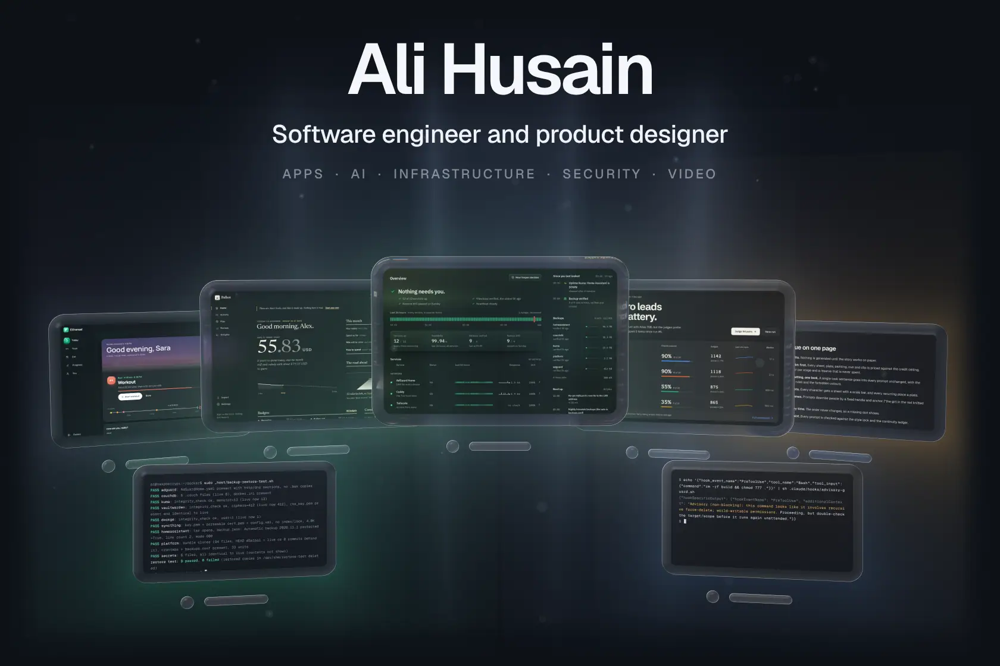</picture></a><a href="https://gallowforge.github.io#gh-light-mode-only"><picture><source media="(max-width: 767px)" srcset="docs/hero6-light-phone.webp 2.835x"><source srcset="docs/hero6-light.webp 2x">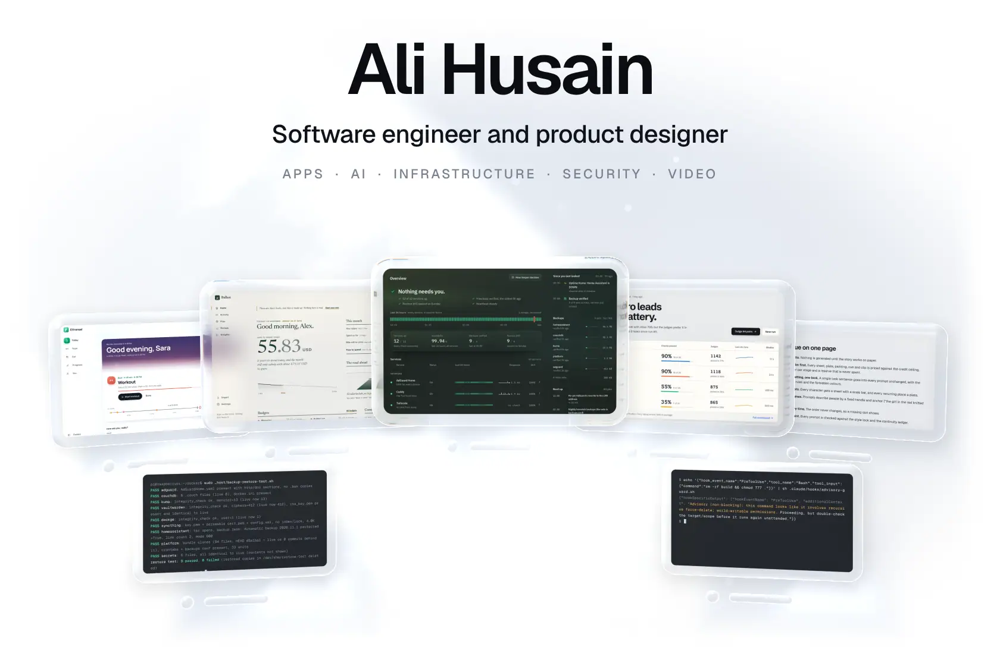</picture></a>

<a href="https://gallowforge.github.io#gh-dark-mode-only"><picture><source media="(max-width: 767px)" srcset="docs/intro4-dark-phone.webp 2.835x"><source srcset="docs/intro4-dark.webp 2x">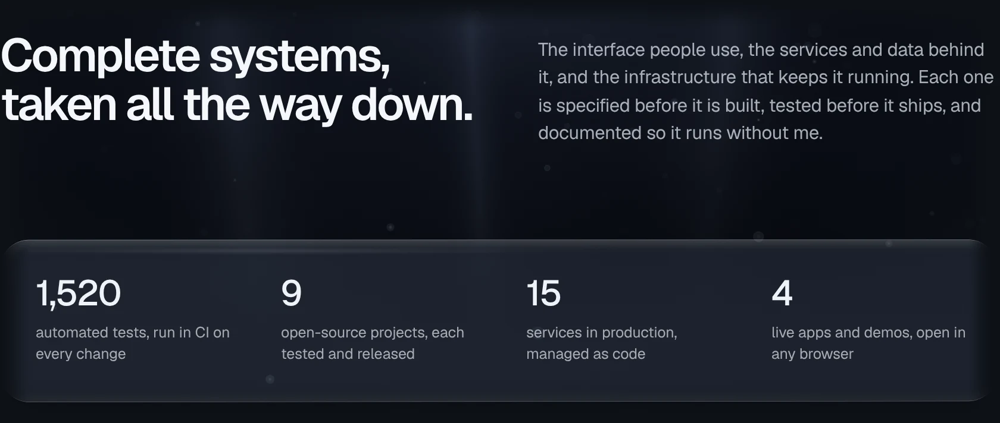</picture></a><a href="https://gallowforge.github.io#gh-light-mode-only"><picture><source media="(max-width: 767px)" srcset="docs/intro4-light-phone.webp 2.835x"><source srcset="docs/intro4-light.webp 2x">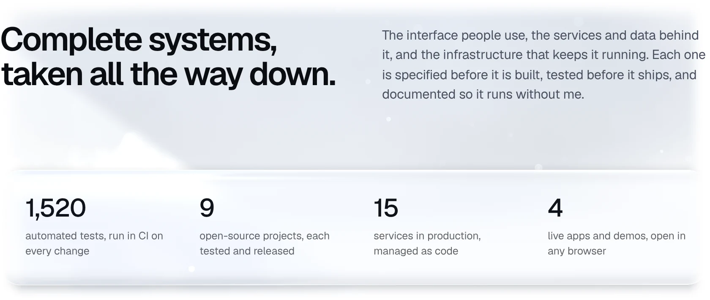</picture></a>

<a href="mailto:ali@gallowforge.dev"><picture><source media="(prefers-color-scheme: dark) and (max-width: 767px)" srcset="docs/btn-email-dark-phone.webp 3x"><source media="(prefers-color-scheme: dark)" srcset="docs/btn-email-dark.webp 2x"><source media="(max-width: 767px)" srcset="docs/btn-email-light-phone.webp 3x"><source srcset="docs/btn-email-light.webp 2x"></picture></a><a href="https://gallowforge.github.io"><picture><source media="(prefers-color-scheme: dark) and (max-width: 767px)" srcset="docs/btn-portfolio-dark-phone.webp 3x"><source media="(prefers-color-scheme: dark)" srcset="docs/btn-portfolio-dark.webp 2x"><source media="(max-width: 767px)" srcset="docs/btn-portfolio-light-phone.webp 3x"><source srcset="docs/btn-portfolio-light.webp 2x"></picture></a><a href="https://gallowforge.github.io/assets/Ali-Husain-CV.pdf"><picture><source media="(prefers-color-scheme: dark) and (max-width: 767px)" srcset="docs/btn-cv-dark-phone.webp 3x"><source media="(prefers-color-scheme: dark)" srcset="docs/btn-cv-dark.webp 2x"><source media="(max-width: 767px)" srcset="docs/btn-cv-light-phone.webp 3x"><source srcset="docs/btn-cv-light.webp 2x"></picture></a>

 

<a href="https://gallowforge.github.io/Ethereal/#gh-dark-mode-only"><picture><source media="(max-width: 767px)" srcset="docs/ethereal2-dark-phone.webp 2.835x"><source srcset="docs/ethereal2-dark.webp 2x"></picture></a><a href="https://gallowforge.github.io/Ethereal/#gh-light-mode-only"><picture><source media="(max-width: 767px)" srcset="docs/ethereal2-light-phone.webp 2.835x"><source srcset="docs/ethereal2-light.webp 2x">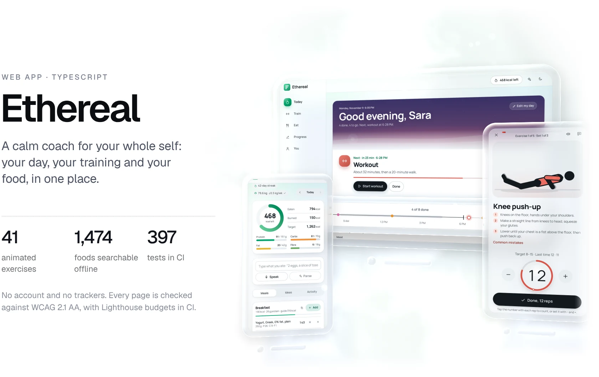</picture></a>

<a href="https://gallowforge.github.io/Ethereal/"><picture><source media="(prefers-color-scheme: dark) and (max-width: 767px)" srcset="docs/btn-open-dark-phone.webp 3x"><source media="(prefers-color-scheme: dark)" srcset="docs/btn-open-dark.webp 2x"><source media="(max-width: 767px)" srcset="docs/btn-open-light-phone.webp 3x"><source srcset="docs/btn-open-light.webp 2x"></picture></a><a href="https://github.com/gallowforge/Ethereal"><picture><source media="(prefers-color-scheme: dark) and (max-width: 767px)" srcset="docs/btn-code-dark-phone.webp 3x"><source media="(prefers-color-scheme: dark)" srcset="docs/btn-code-dark.webp 2x"><source media="(max-width: 767px)" srcset="docs/btn-code-light-phone.webp 3x"><source srcset="docs/btn-code-light.webp 2x"></picture></a>

<a href="https://gallowforge.github.io/ballast/#gh-dark-mode-only"><picture><source media="(max-width: 767px)" srcset="docs/ballast-dark-phone.webp 2.835x"><source srcset="docs/ballast-dark.webp 2x">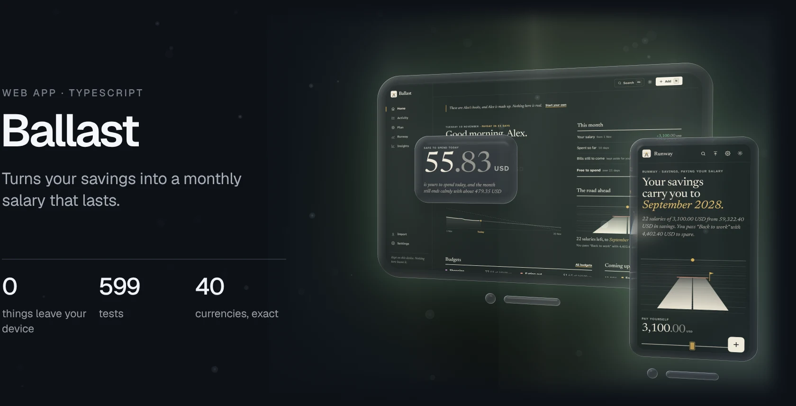</picture></a><a href="https://gallowforge.github.io/ballast/#gh-light-mode-only"><picture><source media="(max-width: 767px)" srcset="docs/ballast-light-phone.webp 2.835x"><source srcset="docs/ballast-light.webp 2x">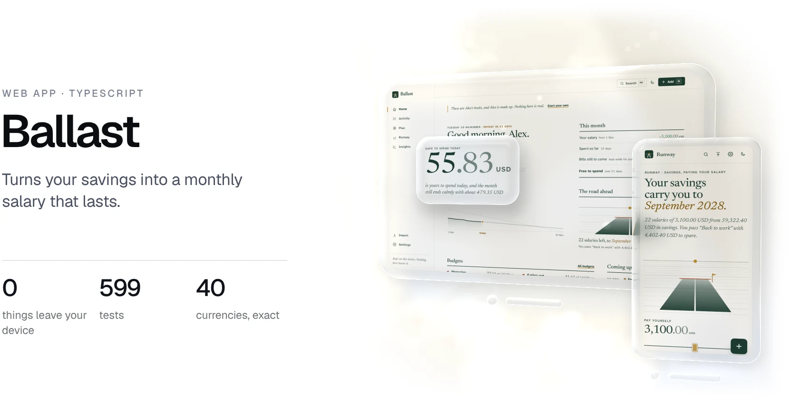</picture></a>

<a href="https://gallowforge.github.io/ballast/"><picture><source media="(prefers-color-scheme: dark) and (max-width: 767px)" srcset="docs/btn-open-dark-phone.webp 3x"><source media="(prefers-color-scheme: dark)" srcset="docs/btn-open-dark.webp 2x"><source media="(max-width: 767px)" srcset="docs/btn-open-light-phone.webp 3x"><source srcset="docs/btn-open-light.webp 2x"></picture></a><a href="https://github.com/gallowforge/ballast"><picture><source media="(prefers-color-scheme: dark) and (max-width: 767px)" srcset="docs/btn-code-dark-phone.webp 3x"><source media="(prefers-color-scheme: dark)" srcset="docs/btn-code-dark.webp 2x"><source media="(max-width: 767px)" srcset="docs/btn-code-light-phone.webp 3x"><source srcset="docs/btn-code-light.webp 2x"></picture></a>

<a href="https://github.com/gallowforge/evalbench#gh-dark-mode-only"><picture><source media="(max-width: 767px)" srcset="docs/card-evalbench3-dark-phone.webp 2.835x"><source srcset="docs/card-evalbench3-dark.webp 2x"></picture></a><a href="https://github.com/gallowforge/evalbench#gh-light-mode-only"><picture><source media="(max-width: 767px)" srcset="docs/card-evalbench3-light-phone.webp 2.835x"><source srcset="docs/card-evalbench3-light.webp 2x">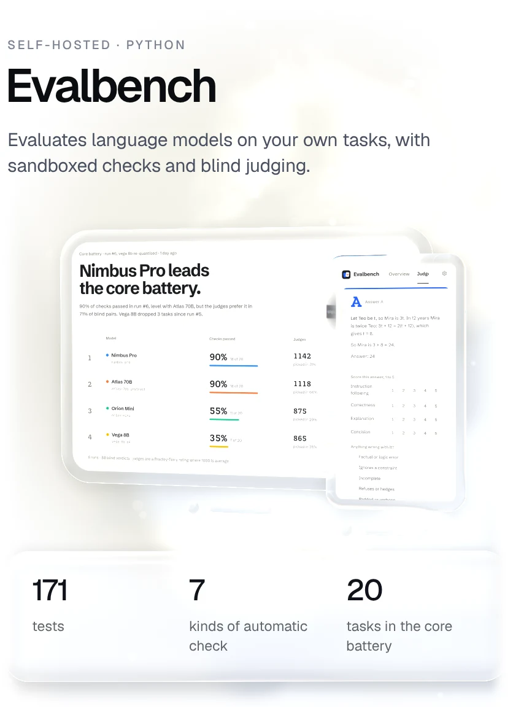</picture></a> <a href="https://github.com/gallowforge/vesper#gh-dark-mode-only"><picture><source media="(max-width: 767px)" srcset="docs/card-vesper3-dark-phone.webp 2.835x"><source srcset="docs/card-vesper3-dark.webp 2x">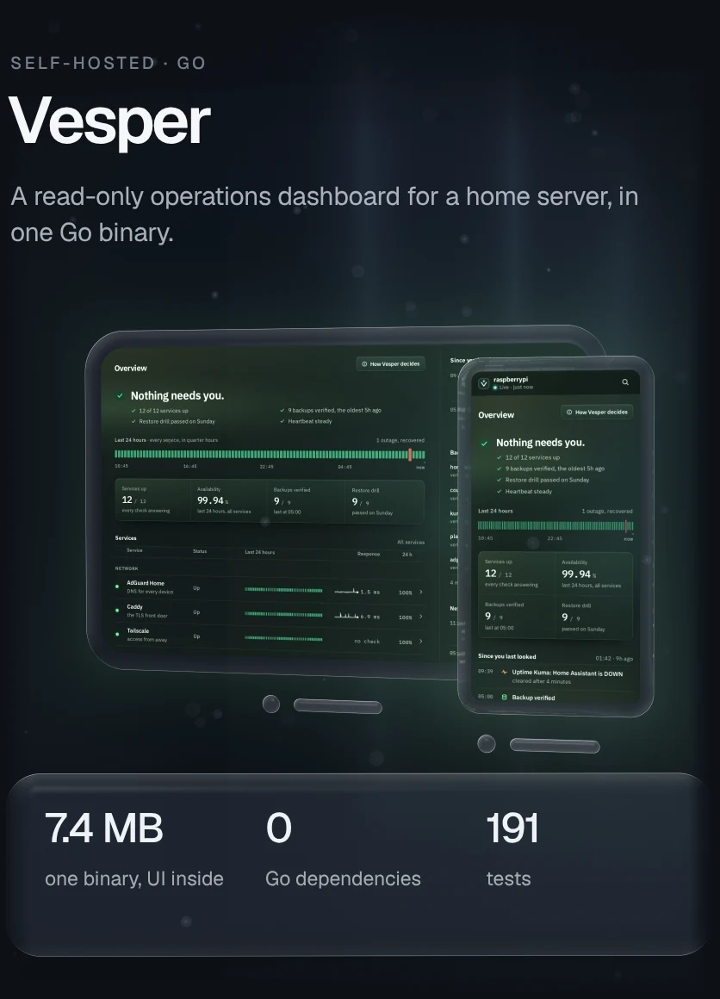</picture></a><a href="https://github.com/gallowforge/vesper#gh-light-mode-only"><picture><source media="(max-width: 767px)" srcset="docs/card-vesper3-light-phone.webp 2.835x"><source srcset="docs/card-vesper3-light.webp 2x">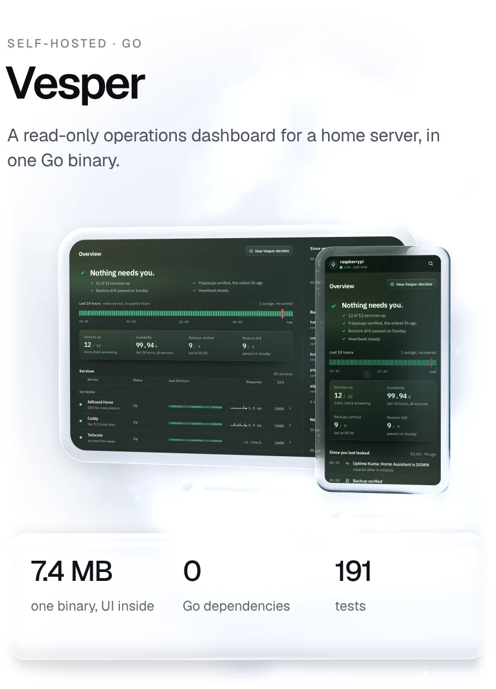</picture></a>

<a href="https://github.com/gallowforge/homelab#gh-dark-mode-only"><picture><source media="(max-width: 767px)" srcset="docs/card-homelab-dark-phone.webp 2.835x"><source srcset="docs/card-homelab-dark.webp 2x">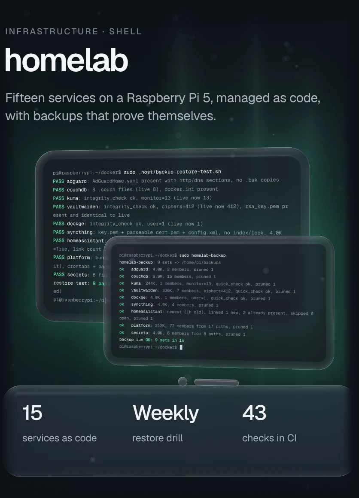</picture></a><a href="https://github.com/gallowforge/homelab#gh-light-mode-only"><picture><source media="(max-width: 767px)" srcset="docs/card-homelab-light-phone.webp 2.835x"><source srcset="docs/card-homelab-light.webp 2x">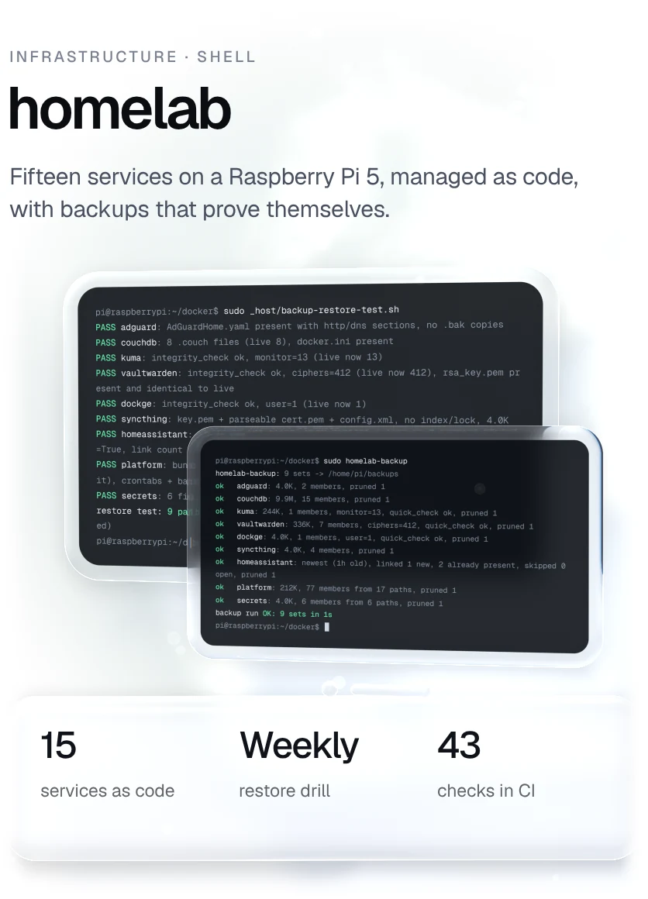</picture></a> <a href="https://github.com/gallowforge/filmforge#gh-dark-mode-only"><picture><source media="(max-width: 767px)" srcset="docs/card-filmforge-dark-phone.webp 2.835x"><source srcset="docs/card-filmforge-dark.webp 2x">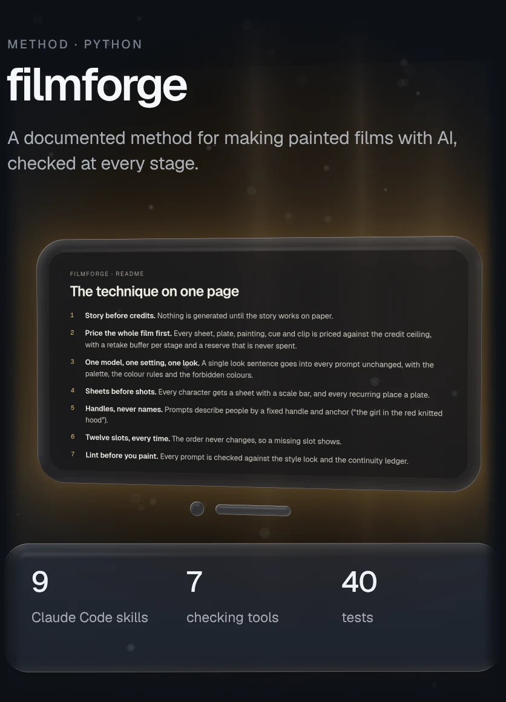</picture></a><a href="https://github.com/gallowforge/filmforge#gh-light-mode-only"><picture><source media="(max-width: 767px)" srcset="docs/card-filmforge-light-phone.webp 2.835x"><source srcset="docs/card-filmforge-light.webp 2x">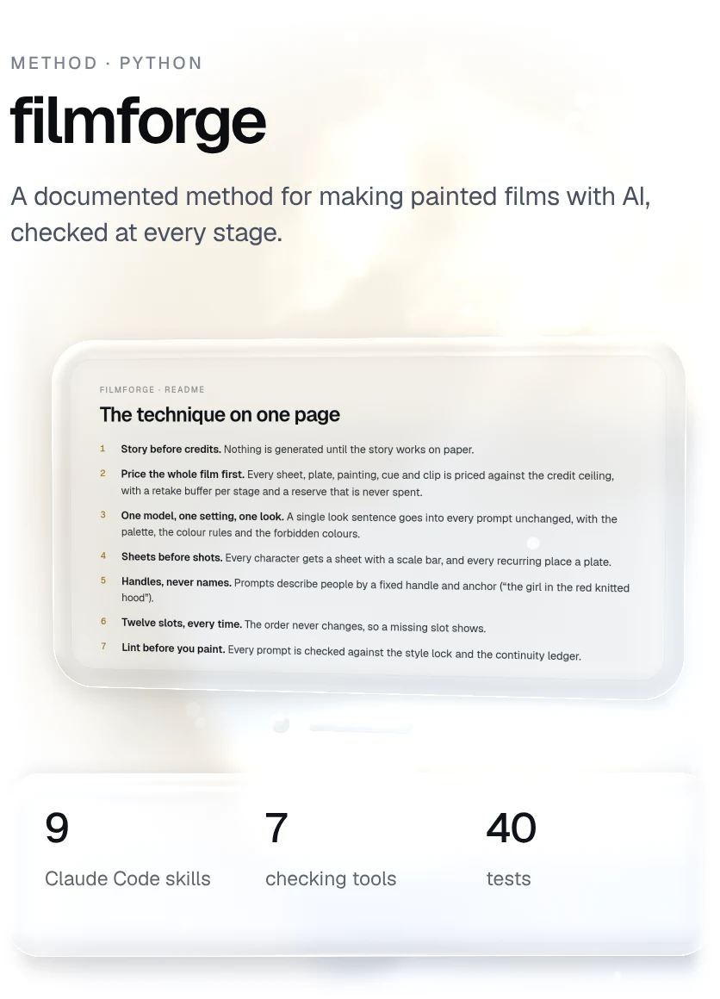</picture></a>

<a href="https://github.com/gallowforge/aih#gh-dark-mode-only"><picture><source media="(max-width: 767px)" srcset="docs/tool-aih-dark-phone.webp 2.835x"><source srcset="docs/tool-aih-dark.webp 2x">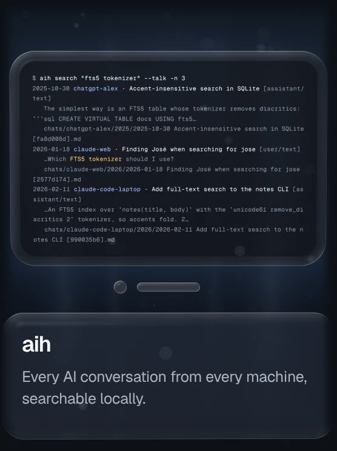</picture></a><a href="https://github.com/gallowforge/aih#gh-light-mode-only"><picture><source media="(max-width: 767px)" srcset="docs/tool-aih-light-phone.webp 2.835x"><source srcset="docs/tool-aih-light.webp 2x">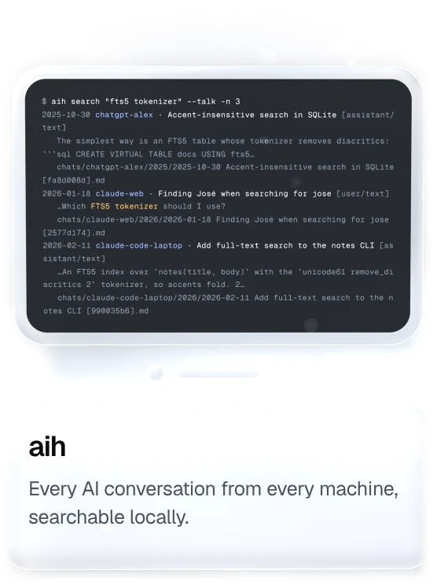</picture></a><a href="https://github.com/gallowforge/agent-guardrails#gh-dark-mode-only"><picture><source media="(max-width: 767px)" srcset="docs/tool-guardrails-dark-phone.webp 2.835x"><source srcset="docs/tool-guardrails-dark.webp 2x">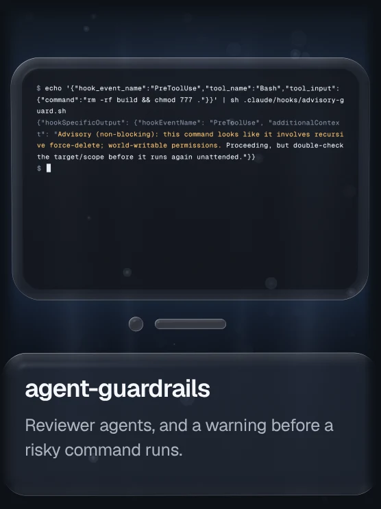</picture></a><a href="https://github.com/gallowforge/agent-guardrails#gh-light-mode-only"><picture><source media="(max-width: 767px)" srcset="docs/tool-guardrails-light-phone.webp 2.835x"><source srcset="docs/tool-guardrails-light.webp 2x">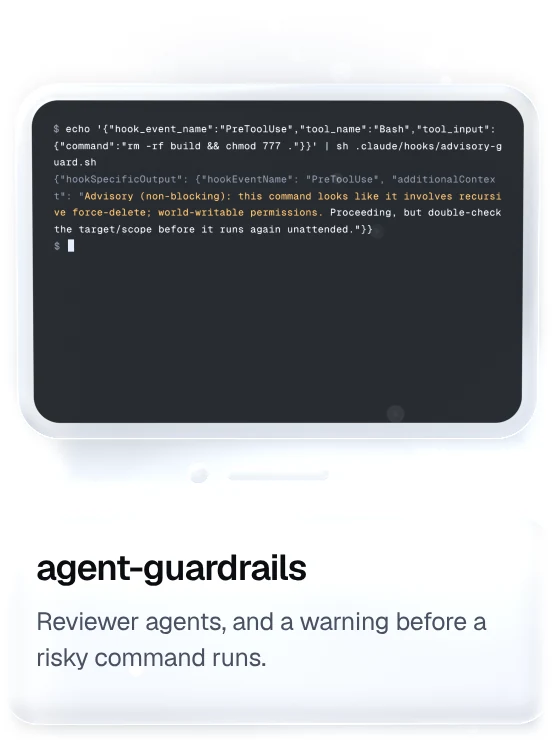</picture></a><a href="https://github.com/gallowforge/bwtidy#gh-dark-mode-only"><picture><source media="(max-width: 767px)" srcset="docs/tool-bwtidy-dark-phone.webp 2.835x"><source srcset="docs/tool-bwtidy-dark.webp 2x">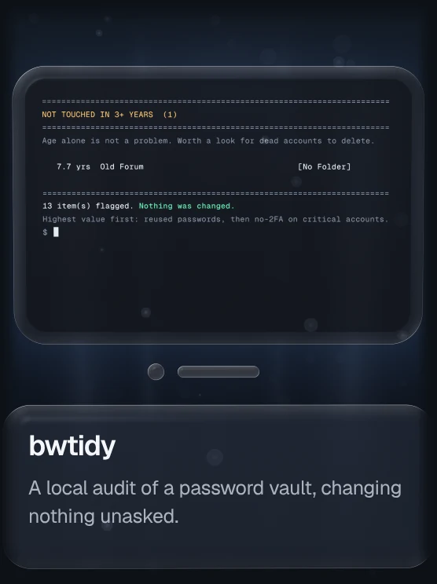</picture></a><a href="https://github.com/gallowforge/bwtidy#gh-light-mode-only"><picture><source media="(max-width: 767px)" srcset="docs/tool-bwtidy-light-phone.webp 2.835x"><source srcset="docs/tool-bwtidy-light.webp 2x">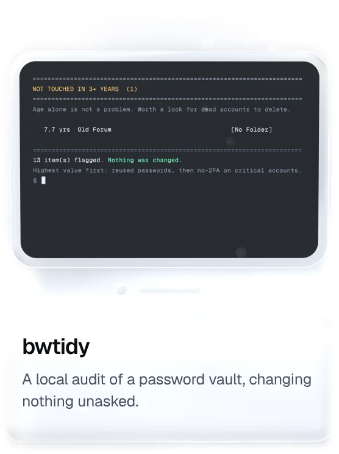</picture></a>

 

<a href="https://gallowforge.github.io#gh-dark-mode-only"><picture><source media="(max-width: 767px)" srcset="docs/principles3-dark-phone.webp 2.835x"><source srcset="docs/principles3-dark.webp 2x">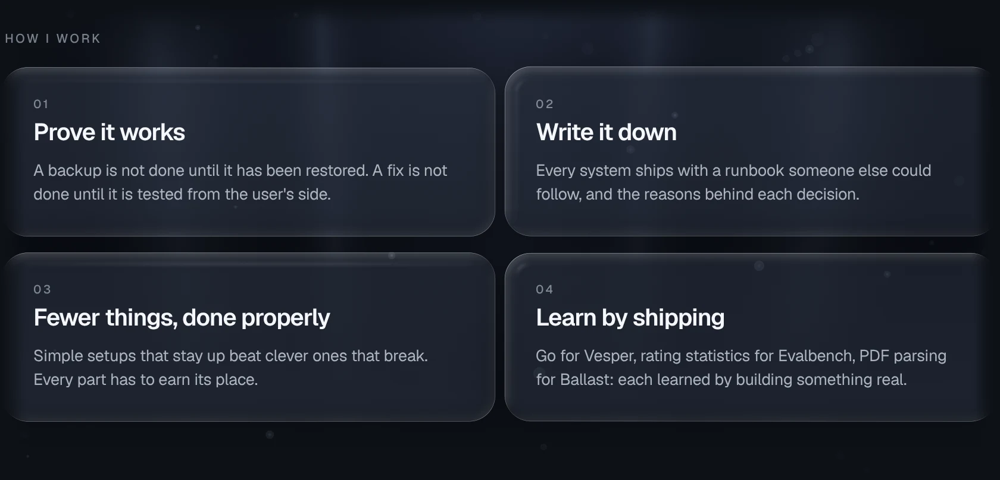</picture></a><a href="https://gallowforge.github.io#gh-light-mode-only"><picture><source media="(max-width: 767px)" srcset="docs/principles3-light-phone.webp 2.835x"><source srcset="docs/principles3-light.webp 2x">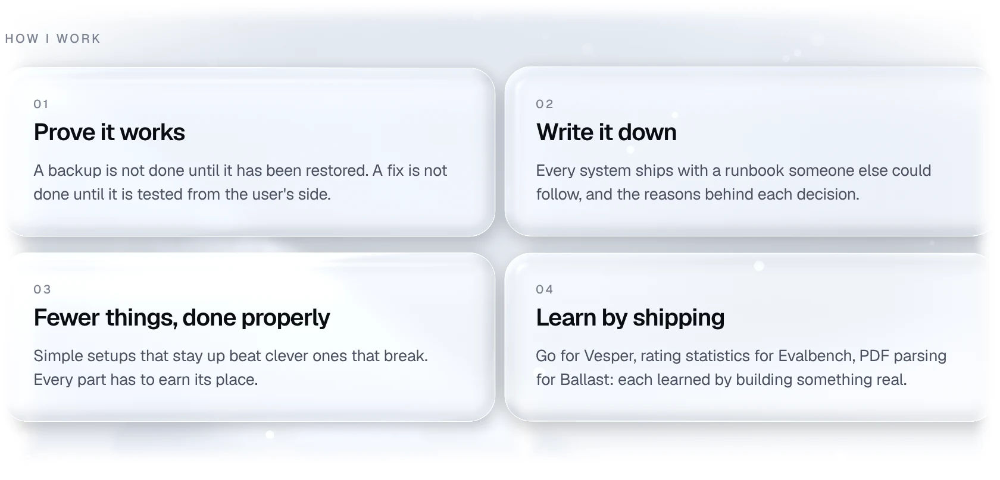</picture></a>

<a href="mailto:ali@gallowforge.dev"><picture><source media="(prefers-color-scheme: dark) and (max-width: 767px)" srcset="docs/contact-dark-phone.webp 2.835x"><source media="(prefers-color-scheme: dark)" srcset="docs/contact-dark.webp 2x"><source media="(max-width: 767px)" srcset="docs/contact-light-phone.webp 2.835x"><source srcset="docs/contact-light.webp 2x">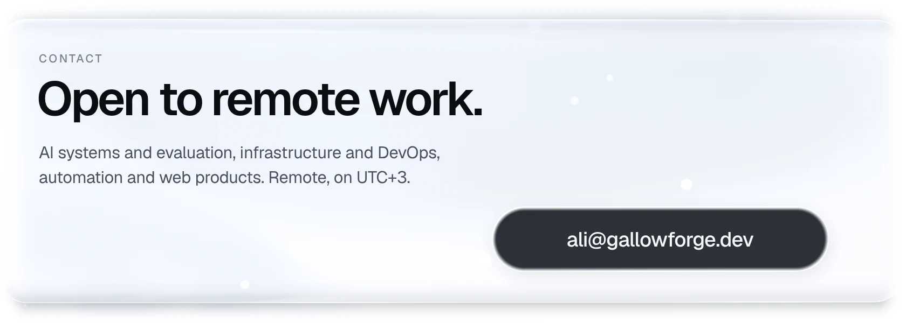</picture></a>
